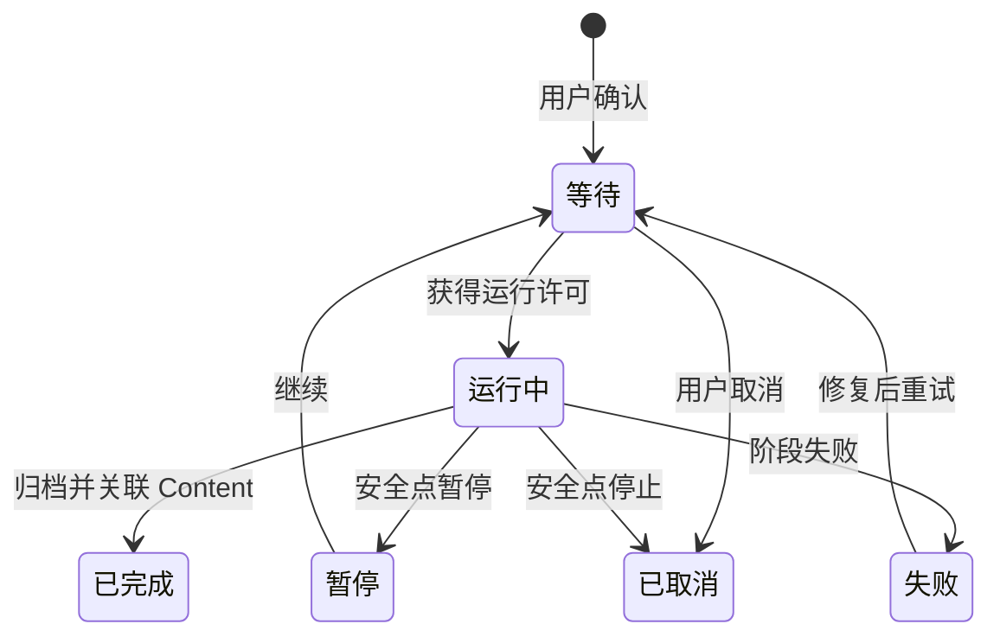

# 分 PRD｜任务

> v5.1 · 2026-10-14 · 状态：需求草案。任务是当前一级板块；队列是其内部处理机制，不单独占导航或分册。

## 1. 前置引用

本模块属于《多源内容知识库》总 PRD 的「任务」模块。产品整体目标、目标用户与全局约束以 [总 PRD](00_总PRD.md) 为准；本文只规定任务状态、队列运行与恢复规则。

## 2. 本模块价值与局部痛点

### 用户可见任务

**模块价值**：让用户能够判断已提交任务的状态、当前阶段、失败后的可执行动作和处理结果位置。

**局部痛点**：任务异步运行且包含多个处理阶段。若提交反馈、进度和失败原因不可见，用户无法分辨任务是否创建、为何等待、失败后如何恢复，或结果保存在哪里。

### 运行与队列

**模块价值**：在本机资源有限时，让多个任务按可解释的顺序运行，并在中断后恢复。

**局部痛点**：多个任务竞争本机资源，来源访问也有节奏限制。若排队原因、资源上限和阶段检查点不清楚，一项失败可能拖住整批，应用重启后也难以判断从哪里继续。

## 3. 本模块目标与衡量指标

### 用户可见任务

**目标**：用户提交后能判断任务是否存在、进到哪一步、失败为何、结果在哪。S1 固定样本中，刷新和重启后的列表与持久 Job 一致。

**衡量指标**：任务完成率＝产生可打开 Content 的 Job/确认的可处理 Job；失败恢复率＝修复依赖后成功终态的定向重试 Job/发起的可恢复重试 Job。当前无基线。

### 运行与队列

**目标**：单机多任务运行时，顺序、资源、故障和重启行为可解释，且不会因一条失败毁掉整批。S1 重点验证阶段检查点与归档一致性。

**衡量指标**：按 Job 记录排队时长、各阶段耗时、重试次数和归档一致性异常；并发与平台请求上限在真实样本后定值，当前无可信阈值。

## 4. 本模块 Non-Goal

### 用户可见任务

任务不是知识对象；清理 Job 不清理 Content。本期不做团队分派、管理员看板或跨设备状态同步。

### 运行与队列

本期不做云端分布式调度、跨设备接力或平台验证绕过；用户无需理解线程或内部调度器。

## 5. 本模块专属关键使用场景

### 用户可见任务

用户确认导入后，打开任务页查看任务是否进入队列、当前处理阶段和下一步。
任务因登录或模型配置受阻时，用户从失败状态进入设置并查看修复入口。
任务完成后，用户从任务详情打开结果，读完返回原任务和筛选位置。

### 运行与队列

多个任务同时提交且本机资源已占满时，用户查看等待项的原因并调整尚未开始的任务顺序。
应用重启后，用户回到任务页确认中断任务的恢复阶段和已保留材料。
批次中一项失败时，用户查看失败项并只重试该项，其他结果保持可用。

## 6. 本模块用户故事

### 用户可见任务

1. 作为刚提交内容的用户，我希望看到任务状态、当前阶段和结果入口，以便知道处理进展并打开完成内容。
2. 作为遇到失败的用户，我希望看到失败原因和针对性的恢复操作，以便修复后只重试需要处理的任务。

### 运行与队列

3. 作为同时运行多个任务的用户，我希望看到排队原因并调整待运行顺序，以便按当前需要安排本机处理资源。
4. 作为在任务运行期间重启应用的用户，我希望任务从已保存检查点恢复，以便不必无故重复已完成阶段。

## 7. 功能规则、交互流程、验收标准与非功能需求

### 7.1 范围与交互流程

#### 用户可见任务

**主流程**：确认提交 → 创建持久 Job → 等待/运行 → 完成、失败或取消 → 完成时关联本次 Content → 从任务入口阅读结果。阶段推进与资源许可由队列册定义。

| 当前状态 | 触发 | 目标状态 | 可见结果 |
|---|---|---|---|
| 等待 | 获得运行许可/用户取消 | 运行中/已取消 | 开始真实阶段或停止排队 |
| 运行中 | 安全暂停/阶段失败/完成归档/安全取消 | 暂停/失败/已完成/已取消 | 保存阶段与原因；取消中不冒充终态 |
| 暂停或失败 | 继续或修复后重试 | 等待 | 重新检查授权与配置后排队 |

#### 运行与队列

**主流程**：待运行 → 获取对应资源许可 → 检查来源 → 获取内容 → 转换文字 → 生成总结 → 保存完成。每步完成证据先持久化，再推进；暂停、失败、取消均保留可解释的当前位置。

| 阶段 | 输入条件 | 阶段完成的证据 | 常见阻断 |
|---|---|---|---|
| 1 检查来源 | 有有效 Job 和输入快照 | 来源仍可访问、运行条件/授权结果保存 | 登录过期、平台风控、输入已失效 |
| 2 获取内容 | 来源可读取 | 原始正文、字幕或媒体材料取得并记录来源 | 原文删除、网络中断、无可用材料 |
| 3 转换文字 | 材料已取得 | 正文/字幕规范化或 ASR/OCR 结果与位置保存 | 模型缺失、转写失败、资源不足 |
| 4 生成总结 | 文本材料和模型条件满足 | 文案版本及使用材料范围保存 | API 不可用、上下文超限、证据不足 |
| 5 保存完成 | 有可归档结果 | Content/档案可读取且 Job 关联结果 ID | 路径不可写、存储满、记录不一致 |

内容类型不需要的阶段可以显示“跳过：原因”，不把跳过伪装成已处理。终态为完成、失败或已取消；暂停是可恢复中间状态。错误发生时保留阶段、时间、可恢复材料与错误类别。

### 7.2 页面交互与信息呈现

#### 用户可见任务

| 区域/字段 | 默认与展示 | 操作/边界 |
|---|---|---|
| 状态筛选 | 全部、进行中、等待、已完成、失败、已取消 | 切换筛选不改任务状态 |
| 任务卡片 | 标题、来源、真实阶段、更新时间 | 点开详情，终态动作按状态开放 |
| 阶段详情 | 五阶段时间线、原因与可用材料 | 失败给修复/重试；完成给本次结果 |

任务首页顶部是“全部、进行中、等待、已完成、失败、已取消”状态筛选。每项任务显示标题/封面或通用图标、来源、当前状态、五阶段位置、耗时或最近更新时间。错误优先显示发生阶段、中文原因和恢复建议，不只显示机器错误码。

| 状态 | 用户应看到 | 允许的动作 |
|---|---|---|
| 等待 | 排队或缺少运行条件的原因、提交时间；不是假进度 | 查看详情、调整允许的顺序、暂停或取消 |
| 进行中 | 当前真实阶段及已完成阶段；无进度百分比依据时只显示阶段 | 查看详情、按可中断条件暂停/取消 |
| 暂停 | 暂停是用户操作还是系统条件造成，已完成材料是否保留 | 继续、取消 |
| 已完成 | 对应 Content 的“查看结果”与处理完成时间 | 打开结果、清理任务记录；不误删内容 |
| 失败 | 失败阶段、原因、已保留中间材料及可用时限 | 解决依赖、仅重试失败项或删除记录 |
| 已取消 | 实际停止时间及是否已有归档结果 | 查看记录；不得显示仍会自动运行 |

未归类的同批任务按独立项展示；用户在接入时选了归类的批次，可用淡色外框相邻包裹、显示批次成功/失败数。这个 `TaskDisplayGroup` 是视觉分组，不创建第二套任务或知识实体。

#### 运行与队列

| 可见位置 | 必须显示 | 用户动作 |
|---|---|---|
| 任务等待卡片 | 排队、资源忙、平台冷却或配置缺失的真实原因 | 查看详情、允许时调整顺序 |
| 任务阶段详情 | 当前阶段、已完成证据、失败阶段 | 暂停/取消/重试依真实安全点开放 |
| 批次反馈 | 成功、失败、跳过分别计数 | 仅对失败项发起重试 |

任务等待时显示“前方还有任务”“本地模型/资源忙”“等待平台访问冷却”或“需重新登录”等事实原因。用户调整队列顺序或优先级时立即反馈新的待运行顺序；不能保证已运行任务被抢占。批量暂停/继续/取消可按所选 Job 逐条返回结果，一条失败不回滚其他成功项。

### 7.3 功能规则

#### 用户可见任务

下表只写触发与产品行为；验收集中在第 7.5 节。事实、约束、触发、推论与计算按规则性质区分，不为凑类别虚构公式。

| ID | 规则与可见行为 |
|---|---|
| TK-01 | 接入确认成功时创建 Job，记录来源、批次、归类和处理配置快照；页面反馈成功/跳过/失败数 |
| TK-02 | 任务状态只由实际处理状态驱动；刷新或重启后从持久记录恢复展示 |
| TK-03 | 任务详情展示五阶段时间线、开始/结束时间、材料路径与配置快照；未进入阶段不标完成 |
| TK-04 | 暂停/继续/取消只作用于目标任务；不可立即中断的操作显示“取消中”直至终态 |
| TK-05 | 失败项给出针对错误的恢复建议；重试前重新检查失效登录或模型配置 |
| TK-06 | 已完成项关联本次任务的 Content；从任务进入详情后按产品父级返回任务列表、筛选和位置 |
| TK-07 | 已完成任务记录保留到用户主动删除；删除任务记录不删除已归档 Content |
| TK-08 | 失败中间材料对普通页面不可见，保留 24 小时用于续跑；超期重试从头开始 |
| TK-09 | 批次内部分失败不覆盖成功；失败项 ID 可用于定向重试 |
| TK-10 | 配置不足时从任务进入设置；保存并检查后返回触发配置的任务父级 |

**任务与内容的边界**：用户“重新分析同一来源”可能产生新的 Content；用户“编辑已归档总结”产生同一 Content 的新版本。任务页操作名称和提示须区分二者。回收站中的内容不会因重试批量归类被自动恢复。

**阶段归属**：S1 以 TK-01～TK-08、TK-10 完成单条及混合批次闭环；TK-09 的失败项定向重试在 S2 集合扩大前必须验收。若当前 UI 已显示 S2 操作，也应明确其待验收状态。

#### 运行与队列

下表只写触发与产品行为；验收集中在第 7.5 节。事实、约束、触发、推论与计算按规则性质区分，不为凑类别虚构公式。

| ID | 规则与可见行为 |
|---|---|
| QU-01 | 同一资源类型的运行任务受配置上限约束；超出者保持等待并显示原因 |
| QU-02 | 平台扫描、下载和临时错误重试使用有界请求预算；触发人工验证/限流后停止自动连续请求 |
| QU-03 | 排序与优先级只作用于待运行队列；批量控制逐任务反馈 |
| QU-04 | 每阶段开始、完成或失败写持久事件；完成证据保存后才进入下一阶段 |
| QU-05 | 临时网络/外部服务失败可按有界策略自动重试；账号过期、验证码、模型缺配置不自动换方案 |
| QU-06 | 归档与 Job 完成应指向同一有效 Content；进程中断不能静默生成重复结果 |
| QU-07 | 取消等待任务后不启动；运行任务到安全点结束，清理未完成副作用 |
| QU-08 | 失败阶段可在 24 小时内从最后成功阶段后续跑；超期从来源重新开始；重新总结从头处理 |
| QU-09 | 批量中的成功、失败、跳过分别计数；失败项定向重试不重新跑成功项 |

并发数、重试次数与退避间隔应在真实本机资源和平台行为测试后写入运行配置与验收记录；当前不能从“有上限”推断已测得某个安全数字。没有确定上限的来源不能开启大范围自动扫描。运行中暂停能力要按真实可中断阶段开放，不能只改变前端按钮文字。

**阶段归属**：S1 验证 QU-01、QU-04～QU-08 的单机处理与恢复；S2 扩大到 QU-02、QU-03、QU-09 的集合节奏、排序和部分失败。当前代码已提供的批量控制须复测，不等于后续平台扫描自动获批。

### 7.4 异常处理、非功能需求与数据边界

#### 用户可见任务

**质量约束**：刷新/重启后展示应与持久 Job 一致；失败提示说明阶段与下一动作；状态不能只靠颜色，不能以动画代替真实进度。

- 无任务时，说明可从内容接入创建第一项；筛选结果为空时提供清除筛选，不误报“从未创建任务”。
- 任务创建后停留接入区的小型运行提示可以跳到任务；任务页不应强制抢焦点。
- 归档成功但写回任务状态失败时，不应出现两个互相矛盾的“结果”；恢复后应能关联同一 Content 或显式诊断，见队列 QU-06。
- 任务结果页的返回规则按语义父级：任务列表 → 任务详情 → 内容结果。筛选、排序、弹窗不是新层级；没有父级时不显示无效返回。

#### 运行与队列

**质量约束**：资源占用与请求重试必须有界；关闭页面不取消 Job；进程重启按持久证据恢复；事件与诊断不得记录会话秘密。

- 保存阶段失败时，用户看到“归档失败”及路径/空间原因；不能显示“已完成”却无法从总库打开。
- 对来源读取受限、模型失败、磁盘不足和用户取消分别记录阶段与恢复方式。敏感令牌不写事件正文。
- 页面关闭与进程关闭不同：关闭页面不取消任务；进程重启时按持久检查点恢复或进入可解释失败。
- 记录排队时间、实际运行时间、阶段耗时、重试数、可得的外部费用，供 S1 形成资源/成本基线。不把初步样本推成 SLA。

运行队列与本篇用户可见任务状态相互约束；还依赖[内容接入](01_内容接入_PRD.md)的来源请求预算，以及[知识库](03_知识库_PRD.md)的材料充足判断和归档身份。个人开发者需在 S2 集合扫描前确定每个平台的请求预算与可接受的限流处理。

### 7.5 验收标准

#### 用户可见任务

| 覆盖需求 | Given／When／Then 验收 |
|---|---|
| TK-01/02 | 给定混合批次提交，当刷新及重启应用，则任务记录与提交反馈的成功/跳过/失败计数一致。 |
| TK-04 | 给定一个等待任务和一个运行任务，当分别取消，则等待项不再启动，运行项在安全点终止，其余 Job 不受影响。 |
| TK-06/07 | 给定完成 Job，当打开结果并删除任务记录，则返回任务父页且总库 Content 仍可打开。 |

**逐条观察点**：下表与第 6 章需求一一对应，复用上面的场景前提执行。

| ID | 可观察结果 |
|---|---|
| TK-01 | 混合批次提交结果数与持久任务记录一一对应 |
| TK-02 | 运行中重启、已完成、失败三类样本的列表与真实记录一致 |
| TK-03 | 逐阶段样本中当前阶段与真实执行记录一致；失败能看到失败阶段 |
| TK-04 | 取消等待项后不会启动；取消运行项不假称立刻停止，其余任务继续 |
| TK-05 | 网络暂断、模型不可用、来源受限分别得到不同提示；修复后可只重试目标项 |
| TK-06 | 相同结果从任务和知识库各打开一次，返回不同来路；不靠浏览器访问历史 |
| TK-07 | 删除完成任务后总库仍能找到对应内容；删除前文案说明影响 |
| TK-08 | 期限内/期限外各模拟一次，起点与提示相符，不把过期材料当可复用 |
| TK-09 | 3 条混合任务中 1 失败，成功结果可直接阅读，重试只处理失败项 |
| TK-10 | 缺模型样本从任务去设置再返回，仍可见原任务与筛选 |

验收记录须写明素材/任务 ID、客户端版本、运行环境、自动检查结果与人工观察结果。页面外观、理解质量和真实平台授权须人工核对；未做的项标“待人工验收”，不能因源码可见直接标“通过”。

#### 运行与队列

| 覆盖需求 | Given／When／Then 验收 |
|---|---|
| QU-01 | 给定超出资源上限的一批 Job，当开始处理，则实际运行数不超限，等待项不标为运行中。 |
| QU-04/06 | 给定在归档前与归档后两次中断，当应用恢复，则 Job 与有效 Content 关联一致，没有第二个静默结果。 |
| QU-08/09 | 给定 24 小时内和超期失败项，当重试，则前者从可用检查点续跑，后者从来源开始，成功项不重复运行。 |

**逐条观察点**：下表与第 6 章需求一一对应，复用上面的场景前提执行。

| ID | 可观察结果 |
|---|---|
| QU-01 | 提交超过上限的批次，实际运行数不超限，等待任务未标“正在处理” |
| QU-02 | 用限流与验证码样本检查：任务停在明确状态，不形成无间隔请求循环 |
| QU-03 | 拖动两个等待项后执行顺序更新；运行项继续原阶段 |
| QU-04 | 中途强制退出并重开，恢复点与已有材料一致，不重复标记未完成阶段 |
| QU-05 | 三类故障触发不同路径，达重试上限后进入失败并给出用户动作 |
| QU-06 | 在归档前后中断恢复，任务与知识库关联一致；异常时有可修复诊断 |
| QU-07 | 混合批次取消一项，其余照常终态；取消项不展示半成品为完成 |
| QU-08 | 期限前后与重新总结各执行一次，阶段起点、材料和新 Content/版本关系均正确 |
| QU-09 | 一批三种终态的数量之和等于提交项，重试仅生成失败项的新运行记录 |

验收记录须写明素材/任务 ID、客户端版本、运行环境、自动检查结果与人工观察结果。页面外观、理解质量和真实平台授权须人工核对；未做的项标“待人工验收”，不能因源码可见直接标“通过”。

## 8. 风险与开放问题

### 8.1 依赖、风险与开放问题

#### 用户可见任务

记录 Job 创建、开始、终态、失败阶段、取消/重试次数、结果 Content ID；统计按来源和任务类型分组。单纯“有任务记录”不是成功，必须与可读结果和归档状态一起判断。

依赖 [内容接入](01_内容接入_PRD.md) 的来源快照、本篇运行与队列规则的运行/恢复事件、[知识库](03_知识库_PRD.md) 的结果身份、[设置](04_设置_PRD.md) 的配置检查。待决项是运行中哪些阶段可以安全暂停；没有已验证中断点的阶段，界面不能承诺即时暂停。任务的其他规则以当前五图已有决定为准。

**决策边界**：运行中可安全暂停的阶段须先按真实处理器验证；未确认前不承诺即时暂停。

#### 运行与队列

请求预算、退避和并发数由个人开发者依据本机资源与平台限流样本在 S2 前确定；大范围扫描不能在没有上限时开放。

**决策边界**：请求预算、退避和并发数由个人开发者依据本机资源与平台限流样本在 S2 前确定；大范围扫描不能在没有上限时开放。

### 8.2 参考与变更

主要依据当前五张 XMind、现有任务/队列界面与处理记录。TK 编号描述用户可见任务，QU 编号描述运行和恢复；二者同属当前“任务”板块。

v5.0 按当前导航合并原能力分册；需求编号保留，旧分册不再单独维护。

v5.1（2026-10-14）：按产品全局与子模块职责边界重组章节，保留既有规则、流程和验收内容。
