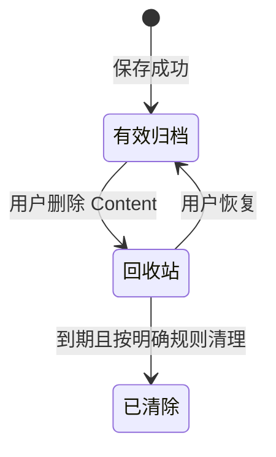

# 分 PRD｜知识库

> v5.4 · 2026-10-31 · 状态：需求草案。知识库是当前一级板块；AI 文案是材料处理与结果阅读能力，不单独占导航或分册。

## 目录

- [1. 前置引用](#1-前置引用)
- [2. 本模块价值与局部痛点](#2-本模块价值与局部痛点)
- [3. 本模块目标与衡量指标](#3-本模块目标与衡量指标)
- [4. 本模块 Non-Goal](#4-本模块-non-goal)
- [5. 本模块专属关键使用场景](#5-本模块专属关键使用场景)
- [6. 本模块用户故事](#6-本模块用户故事)
- [7. 功能规则、交互流程、验收标准与非功能需求](#7-功能规则交互流程验收标准与非功能需求)
- [8. 风险与开放问题](#8-风险与开放问题)
- [9. 调研附录｜RAG 链路的切分、重排与存储选择](#9-调研附录rag-链路的切分重排与存储选择)
- [10. 调研专题｜RAG 查询策略与评测优化](#10-调研专题rag-查询策略与评测优化)

## 1. 前置引用

本模块属于《多源内容知识库》总 PRD 的「知识库」模块。产品整体目标、目标用户与全局约束以 [总 PRD](00_总PRD.md) 为准；本文只规定归档找回与内容理解总结的模块规则。

后续检索能力的调研摘要见第 9、10 节；其中查询策略、实验流程与评测设计的完整依据见 [Datawhale RAG 查询策略与评测调研](../../过程/调研/Datawhale_RAG查询策略与评测调研.md)。调研是本模块的一个专题，不替代本模块其他需求或 AI 问答详细 PRD。

相关材料：[视频总结方案调研](../../过程/调研/github视频总结方案研究与产品启发.md)、[收藏夹分类笔记](../../过程/笔记/收藏夹分类_默认收藏夹_50条.md)和[生成内容与样例](../../过程/产出/)。这些材料支持后续修订，已确定的行为仍以本文为准。
视频处理的技术背景另见[快速视频总结与 ASR 专题](../../过程/调研/专题研究/fast-video-summary-asr/FINDINGS.md)。
检索链路（切分、向量化、重排、存储）的同类产品对照见本文第 9 节附录；方法论背景见[AI 辅助构建 RAG 调研](../../过程/调研/专题研究/ai-assisted-rag-engineering/FINDINGS.md)。

## 2. 本模块价值与局部痛点

### 归档、组织与找回

**模块价值**：让已归档内容能按用户记得的线索重新找到、阅读、核对和整理。

**局部痛点**：用户再次需要一条已归档内容时，可能只记得主题或观点，不记得原始标题、来源或任务；手动维护标签、收藏夹和版本时，也需要避免一个分类动作意外改变其他关系。

### 内容理解与总结

**模块价值**：帮助用户更快理解已取得的材料，同时看清总结覆盖范围和证据位置。

**局部痛点**：逐条阅读原材料耗时；材料不完整或只有元信息时，生成内容可能流畅却缺乏依据。缺少材料等级、缺口说明和可核对出处，会让用户难以判断总结能否使用。

## 3. 本模块目标与衡量指标

### 归档、组织与找回

**目标**：用户不记得平台或任务编号仍能找回已归档内容，先快速判断，再读正文与出处，并保留自己的整理。S1 验证从任务和总库的双来路。

**衡量指标**：分别记录找回任务成功/失败及耗时、搜索后打开详情、回源、编辑保存和恢复结果；总库数量本身不等于价值。当前无使用基线。

### 内容理解与总结

**目标**：帮助用户更快理解可读取内容，同时明确哪些结论来自材料、哪些范围未覆盖。S1 的硬门槛是 M0 不生成伪完整总结。

**衡量指标**：按材料等级统计可核对事实、重大错误、重要遗漏、拒绝/降级是否恰当；记录用户反馈与模型费用。首轮是人工切片评价，不推总体准确率。

## 4. 本模块 Non-Goal

### 归档、组织与找回

候选和未归档 Job 不进入总库；S1 不承诺跨内容自动合并、语义搜索或 AI 问答。

### 内容理解与总结

本模块不做无来源专家判断、自动发表稿、完整视频画面理解承诺或 AI 问答；用户总结强度已纳入 CP-12 实施设计，功能效果与局部重生成仍待验证。

## 5. 本模块专属关键使用场景

### 归档、组织与找回

用户准备引用一条旧资料、只记得主题或关键词时，打开总库搜索或按标签筛选。
用户在整理内容时打开详情，检查来源和已有分类，再调整标签或收藏夹。
用户修改已有总结时，在保存前确认这是当前内容的新版本。

### 内容理解与总结

用户打开已归档内容准备阅读时，查看总览并决定是否继续核对正文和出处。
用户需要引用视频中的步骤或观点时，打开总结里的来源位置核对原材料。
用户提交总结请求后材料只有标题简介或部分字幕时，查看材料不足或覆盖缺口提示。

## 6. 本模块用户故事

### 归档、组织与找回

1. 作为需要找回旧资料的用户，我希望按标题、来源、作者或正文搜索并按分类筛选，以便打开目标内容并核对来源。
2. 作为整理内容的用户，我希望独立调整标签和收藏夹关系，以便改变一种归类时保留其他组织关系。
3. 作为编辑总结的用户，我希望保存后形成同一内容的新版本，以便保留自己的修改并查看历史版本。

### 内容理解与总结

4. 作为阅读归档内容的用户，我希望先看到材料覆盖和总结总览，以便快速判断内容是否值得继续阅读。
5. 作为核对总结的用户，我希望关键事实关联到可用的原文或时间位置，以便验证结论依据。
6. 作为材料不完整的用户，我希望看到缺口并得到相应的部分摘要或材料不足说明，以便不把局部信息当成完整结论。

## 7. 功能规则、交互流程、验收标准与非功能需求

### 7.1 范围与交互流程

#### 归档、组织与找回

**主流程**：归档成功 → 进入总库 → 搜索/标签/收藏夹筛选 → 卡片 → 总览/正文/证据 → 编辑新版本或调整归类 → 返回原语义父级。删除内容与删除任务是两条独立路径。

有效归档才能进入总库。回收站期限仍待产品决定，因此上图的“已清除”仅表达生命周期位置，不承诺当前版本已有自动清理；删除 Content 不改写对应 Job 的历史终态。

#### 内容理解与总结

**主流程**：实际取得的来源材料 → M0/M1/M2 质量判定 → M0 预览或 M1 部分摘要或 M2 完整结构化总结 → 人工核对/反馈 → 编辑版本或重新分析。

| 材料等级 | 实际取得什么 | 允许怎样呈现 |
|---|---|---|
| M0 仅元信息 | 标题、作者、简介或错误诊断，没有正文/字幕/可信文字 | 只做“来源预览/材料不足”，明确尚未理解正文；不得生成带具体论点和细节的完整总结 |
| M1 部分正文 | 可用的正文片段、部分字幕/ASR、部分图片 OCR | 可以生成**部分内容摘要**，标明覆盖范围和缺口；不能写成全片/全文结论 |
| M2 足够正文 | 与本次选定内容范围对应的正文/字幕/转写，可定位来源位置 | 生成总览与结构化总结；关键事实应能回到相应片段/时间/页位置 |

“足够”不是仅看字符数：必须检查内容对象是否匹配、片段是否覆盖用户选定范围、是否只混入平台介绍/广告/诊断文本。若判断仍不可靠，降为 M1 并提示。字幕优先；无字幕时按用户已选 ASR 路径转写，图文 OCR 与图文对齐分别验证。外部模型不可用时不悄悄转另一服务或拿元数据冒充正文。

### 7.2 页面交互与信息呈现

#### 归档、组织与找回

| 位置 | 应如何呈现 | 为什么 |
|---|---|---|
| 书架顶部 | “总库”与用户标签横向排列；搜索和筛选按需展开；收藏夹紧凑呈现 | 用户先决定从全库还是某种分类找起 |
| 内容卡片 | 标题、来源图标/通用来源标记和必要状态优先；简介按需展开，不推动整排卡片 | 多条内容可以快速扫读，不被操作和元数据淹没 |
| 详情顶部 | 标题、来源、可编辑的短简介、简短总览、返回入口 | 先决定是否继续阅读，并知道内容来自哪里 |
| 详情正文 | 结构化总结、侧边目录/锚点、原链接或本地来源、证据位置 | 可以深入阅读和核对，不把 AI 文案当原文 |
| 次要操作 | 版本、编辑、反馈、导出、删除/恢复放在明确但不抢正文的层级 | 常用阅读优先，破坏性操作可辨 |

书架按可用宽度在 2～5 列间调整，窄窗不能挤出内容区；卡片封面保比例，长标题可截断但详情能看全。日间/夜间主题及本地来源图标沿用当前视觉语言。近期 10-12 卡片按钮、浮窗、Logo 与顶栏的末轮视觉项仍需按记录做目标窗口验收；本册不宣称这些细项已经通过。

#### 内容理解与总结

| 输出位置 | 默认与展示 | 操作/边界 |
|---|---|---|
| 结果顶部 | 原始标题、可编辑短简介、总览与材料等级 | 不以建议标题覆盖原标题 |
| 正文与证据 | 目录、结构化内容、可定位出处与缺口 | 关键事实回到片段/时间/页位置 |
| 编辑与版本 | 当前版本、生成材料范围、实际总结强度、保存状态 | 保存失败保留草稿，重分析提示对象差异 |
| 总结提交／重新总结 | 简要／标准／详细三档，默认标准 | 选择随任务快照冻结；结果版本显示实际档位，不将详细档显示为材料完整保证 |

| 输出层 | 回答什么问题 | 产品规则 |
|---|---|---|
| **来源标题** | 原内容叫什么？ | 原始标题单独保留；模型建议的新标题须标注“建议”，不覆盖来源标题 |
| **短简介** | 一眼能知道这是什么？ | 持久可编辑，最多 30 字；不能将未读内容写成确定结论 |
| **总览** | 值不值得继续读？ | 先于正文，简短概括主要主题与价值，不机械重复简介 |
| **结构化总结** | 有哪些重点、过程、证据和结论？ | 按材料类型选择章节：教程可有步骤，访谈可有观点与人，会议可有议题；不强制所有内容同模板 |
| **来源与局限** | 依据在哪里、缺了什么？ | 可定位的关键点关联时间戳/正文片段/图片位置；不可定位或推断要标明 |

结果页先总览、再目录/正文、最后反馈/版本等次要信息；原链接在阅读区始终可找。用户可以复制/导出、对照原材料、编辑并保存为新版本。重生成显示使用的模板、模型路径和材料范围；若会产生新的 Content，操作文案须说明与“编辑当前版本”的差别。

### 7.3 功能规则

#### 归档、组织与找回

下表只写触发与产品行为；验收集中在第 7.5 节。事实、约束、触发、推论与计算按规则性质区分，不为凑类别虚构公式。

- **总库**：按 Content.id 展示所有未删除且归档成功内容，包含无标签、无收藏夹项。同一 Content 在多个标签/收藏夹中可出现，但总库只数一次。
- **标签 Tag**：表达内容属性并支持顶部筛选；Content–Tag 多对多。`无标签` 是虚拟筛选，不是一个系统创建的真实标签。
- **收藏夹 Folder**：表达用户收纳位置；Content–Folder 多对多，与标签完全解耦。旧有子级可平铺展示，新建收藏夹按当前目标固定顶层。
- **历史重复**：同一来源再次导入可形成新 Content，标题/归档名按数字后缀区分，旧项保留。它们可以相互提示来源相同，但未经用户操作不自动合并。编辑同一 Content 的总结只产生新版本。
- **AI 标签**：若总结完成后产生候选，仅达到现有目标置信阈值的候选可呈现给用户；**用户确认后**才写入 Tag 关系，不能自动修改归类。
- **批量归类**：有勾选时作用于勾选项；无勾选时才按当前筛选结果取集合。确认时冻结 Content ID，每次最多 200 个；部分失败只重试失败 ID，已删除项跳过，不自动恢复。

| ID | 规则与可见行为 |
|---|---|
| KB-01 | 归档成功才进入总库；总数按 Content.id 计算，不随筛选变化而改变“总库总数”口径 |
| KB-02 | 搜索标题、来源、作者及可检索正文；来源/作者/排序筛选可组合 |
| KB-03 | 标签与收藏夹各自添加/移除，不互相修改；一个 Content 可进多个收藏夹 |
| KB-04 | 书架卡片标出真实来源；简介默认折叠，展开浮层不推挤同排卡片 |
| KB-05 | 详情展示原链接/文件来源、材料状态、AI 总览和正文；缺失来源字段不编造 |
| KB-06 | 用户编辑简介（最多 30 字）和总结，保存结果明确；失败时草稿保留 |
| KB-07 | 从知识库的总库、标签、收藏夹、批次进入详情，返回逐级恢复语义父级 |
| KB-08 | 从任务结果进入详情，返回任务；不被书架默认路径覆盖 |
| KB-09 | 删除内容前显示影响范围，删除后从有效总库移出；可恢复时保留关系 |
| KB-10 | 批量归类在确认时冻结目标 ID；失败项定向重试，软删除项跳过 |
| KB-11 | 历史重复新建与总结编辑分开显示，来源和版本关系可辨 |
| KB-12 | 导出内容包含必要来源、正文与版本信息；不夹带凭证 |

批量操作的“确认”应明确目标数量与动作；本轮不提供一键撤销历史操作。聚合总结、中文语义搜索与跨内容观点比较需要独立质量与关系规则，S1 不按简单搜索功能冒充已支持。

**阶段归属**：S1 核对 KB-01～KB-09、KB-11、KB-12 的单条归档与找回；KB-10 的批量操作须在 S2 集合和多项归类时单独验收。知识库已有 UI 不等于当前运行数据库、索引与档案路径已全部一致。

#### 内容理解与总结

下表只写触发与产品行为；验收集中在第 7.5 节。事实、约束、触发、推论与计算按规则性质区分，不为凑类别虚构公式。

| ID | 规则与可见行为 |
|---|---|
| CP-01 | 获取材料后记录来源类型、片段/时间位置、覆盖范围、转换方式与版本 |
| CP-02 | M0 材料只显示预览与缺口，不启动或不展示完整总结 |
| CP-03 | M1 输出明确写“部分材料”与未覆盖范围；必要时建议补充材料或重试 |
| CP-04 | M2 结果提供短简介、总览与结构化正文，三层各自承担不同阅读任务 |
| CP-05 | 模型生成的关键事实应关联已保存的材料位置；没有可核对位置的推断须标记 |
| CP-06 | 原始标题、建议标题、简介分别存储/显示，避免跨内容串号 |
| CP-07 | 用户编辑短简介/正文后保存新版本；失败保留草稿，旧版本可读 |
| CP-08 | 重新总结从原始来源重新处理，不以旧总结充当新材料；依当前对象图产生新的内容结果 |
| CP-09 | 总结模板与内容类型匹配；当前已有课程笔记、会议纪要、访谈提纲、观点摘要等入口 |
| CP-10 | 配置不可用、上下文过长或成本边界触发时停止并给出材料/配置/拆分建议 |
| CP-11 | 用户组织用的 AI 标签仅为候选；达到当前目标阈值 0.8 才呈现，用户确认后才建立 Tag 关系；内部检索细词不适用本条 |
| CP-12 | 用户提交或重新总结时选择简要／标准／详细，默认标准；任务实际使用及总结版本记录一致，不把强度当作材料完整性或事实可靠性 |

#### CP-12｜用户选择总结强度（2026-10-31）

**用户原话区（逐字，不许改写）**

U-CP12-01 · 补充：
> 然后总结强度，材料完整性这个，在用户总结的时候，我预期加一个新的功能，让用户选择总结的强度，而这个总结的强度也可以作为一个原数据。

**AI 解释区**

- 需求编号：CP-12。
- 现状：用户要求新增选择与元数据闭环。已核源码存在 quick／standard／deep 枚举，但检查到的工作流固定标准档，现有字段不等于用户功能已实现。
- 原因：用户希望控制总结强度，并让后续检索使用该元数据。

**已纳入的实施设计：** 三档中文名为简要／标准／详细，分别复用 quick／standard／deep，默认 standard；提交前选择，批量任务沿用本批选择，创建任务后冻结。重新生成按现有对象及版本规则处理，设置变化不改旧结果。三档处理同一材料范围，只改变详略，不为短材料凑字；M0／M1／M2 的克制规则优先，不因选详细而生成未知细节。

每个总结版本记录实际强度、材料等级／范围、来源版本、模型与 Prompt 身份；旧数据未知不按字数推断。结果及版本信息可查看这些值，不为 RAG 额外生成完整版备份。RAG 按当前问题的证据缺口决定是否查原文，不按强度强制跳转。字段、分档 Prompt 与验证标准统一见 [RAG 执行契约 §3](../规则/RAG执行契约.md#3-用户总结强度与元数据)。

状态：CP-12 已纳入本轮方案，尚未实现／人工验收；局部重生成等其他能力仍按既有状态逐项验收。

**阶段归属**：S1 重点验收 CP-01～CP-08、CP-10 的可信单条结果；已有模板 CP-09 用真实样本复核；CP-11 的用户标签候选属于 S2 组织增强。CP-12 随本轮总结强度实施任务独立交付，不将已有枚举算作已通过，也不改写 S1 的问答排除边界。

### 7.4 异常处理、非功能需求与数据边界

#### 归档、组织与找回

**质量约束**：总库、筛选结果、空状态与加载失败须区分；窄窗书架可读；磁盘/索引故障不能悄悄删除 Content；导出不得含凭证。

初次空库给“去内容接入”入口；筛选后空结果给清除筛选；总库加载失败显示数据/服务问题，不显示“你没有内容”的假空。若正文档案损坏或磁盘路径失效，保留 Content 记录和诊断入口，不默默删掉卡片。标签创建失败应保留输入，明确未保存。原作者删除来源时本地内容能否继续保存，按用户数据策略与平台约束单独评估。

#### 内容理解与总结

**质量约束**：每次生成应能追溯材料等级和版本；重大事实错误与克制失败分开报告；外部模型不可用不静默换路径；费用与耗时按样本记录。

这是一份**发布前人工样本评估契约**，不是模型成功率声明。先固定样本身份和原材料，再锁定待评版本；每次模板或模型变化重跑受影响切片。

| 评估切片 | 必须观察的失败方式 | S1 通过条件 |
|---|---|---|
| 完整字幕教程与观点视频 | 关键步骤/观点遗漏，或无法回到字幕位置 | 抽查的关键事实都能在材料中定位；发现重大错误则不通过该切片 |
| 无字幕、需 ASR 视频 | 转写错误导致人物/数字/结论错 | 明显转写不确定处不写确定事实；结果说明采用 ASR |
| 只有元数据或来源受限 | 从标题编造正文和时间点 | 不生成完整总结；无虚构细节，这是必须通过的克制场景 |
| 部分字幕/图文缺页 | 把部分内容说成全部内容 | 标注覆盖范围与缺口，不冒充全文理解 |
| 标题与材料不匹配 | 内容串号或沿用错误标题 | 原标题与建议标题分开；结论仅基于当前材料 |
| 长内容 | 截断尾部、前段偏重、成本失控 | 显示实际处理范围；遗漏部分不写成全片完整总结 |

首轮每个切片至少选择能暴露所列失败方式的真实样本，并保留一个未参与模板调试的样本。这个最小覆盖是为了**有意识地查找每类故障**，不用于估计产品总体错误率。由用户或受邀试用者核对“有依据/无依据、重要遗漏、可读性、是否愿意再次使用”；事实错误与克制场景必须单独报告，不用平均分掩盖。没有可用样本或没有达到该切片条件时，不能对外宣称该内容类型已稳定支持。

### 7.5 验收标准

#### 归档、组织与找回

| 覆盖需求 | Given／When／Then 验收 |
|---|---|
| KB-01/03 | 给定未贴标签项和多收藏夹项，当打开总库并移出一个收藏夹，则总库计数不重复，其他关系保持。 |
| KB-07/08 | 给定同一 Content 分别从任务和标签进入，当返回，则各自回到正确父页和筛选。 |
| KB-06/11 | 给定同源再次导入与一次编辑，当保存后，则前者产生第二 Content 并有后缀，后者只增加原 Content 的版本。 |

**逐条观察点**：下表与第 6 章需求一一对应，复用上面的场景前提执行。

| ID | 可观察结果 |
|---|---|
| KB-01 | 任务成功但归档失败项不出现；无标签项仍出现；同一项多归类总库只数一次 |
| KB-02 | 导入含同词不同来源样本，组合筛选结果和计数一致；清除条件回到总库 |
| KB-03 | 移出一个收藏夹后仍在另一收藏夹和原标签中，Content 不删除 |
| KB-04 | 平台和本地样本各一条，图标/通用标记正确；弹层与所属卡片对应 |
| KB-05 | 可回源样本一键到原文；原链接失效样本仍可阅读本地归档并见提示 |
| KB-06 | 30 字边界、连续保存及保存失败各测试一次；旧版本可查看 |
| KB-07 | 三条路径各进入并返回，筛选、对象 ID 和内容锚点合理保留 |
| KB-08 | 用同一 Content 从任务和书架分别进入，返回两种正确父页 |
| KB-09 | 删除、在回收站恢复后标签/收藏夹/版本按定义恢复；任务记录不被顺带删除 |
| KB-10 | 筛选变化后仍作用于确认时集合；已删除项返回 skipped；只重试 failed ID |
| KB-11 | 同源两次导入有两个 Content 与数字后缀；同一 Content 编辑不增加总库数 |
| KB-12 | 导出与页面当前版本一致，可找到来源；导出文件中无会话秘密 |

验收记录须写明素材/任务 ID、客户端版本、运行环境、自动检查结果与人工观察结果。页面外观、理解质量和真实平台授权须人工核对；未做的项标“待人工验收”，不能因源码可见直接标“通过”。

#### 内容理解与总结

| 覆盖需求 | Given／When／Then 验收 |
|---|---|
| CP-02/03 | 给定仅元信息与缺半段字幕两个样本，当生成结果，则前者只作预览，后者明确标“部分材料”与缺口。 |
| CP-05/06 | 给定人物、数字、步骤各一项，当人工抽查，则可核对事实定位到当前材料，推断明确标记。 |
| CP-07/08 | 给定用户编辑后重新分析，当查看对象列表，则编辑只增同一 Content 版本，重新分析不以旧摘要充当输入。 |
| CP-12 | 给定同一材料分别选择三档或不选择，当提交及查看结果版本，则冻结／实际使用／记录值一致，默认标准，旧版本不回写；M0／M1 不因详细档伪装完整。 |

**逐条观察点**：下表与第 6 章需求一一对应，复用上面的场景前提执行。

| ID | 可观察结果 |
|---|---|
| CP-01 | 同一视频的字幕、ASR 和仅元数据样本在结果页能区分来源 |
| CP-02 | 仅元数据样本不出现虚构的步骤、观点、时间戳或“全文总结”标题 |
| CP-03 | 缺半段字幕/部分图片样本不以全片口吻下结论 |
| CP-04 | 真实样本中用户能在总览找到主题、在正文找到细节，不是整段重复 |
| CP-05 | 抽查人物、数字、步骤各一项，可定位的回到原材料，推断不伪装引用 |
| CP-06 | 用标题与正文容易混淆的样本，三处信息与同一 Content 材料一致 |
| CP-07 | 连续保存、网络或磁盘保存失败、切换版本各一次，原始材料不被覆盖 |
| CP-08 | 原总结含一处人为错误时，新结果不把该错误当来源；原 Content 与新 Content 关系可见 |
| CP-09 | 用教程/访谈/观点样本各一次，输出结构与选择一致，不强塞无材料章节 |
| CP-10 | 模型失效和超长样本不能显示假成功；任务保留失败阶段与恢复动作 |
| CP-11 | 候选未确认时知识库用户标签不变；用户拒绝后不偷偷写回 |
| CP-12 | 自动核对档位与版本元数据；人工比较三档详略及材料边界。测试 3 档×3 材料等级至少 9 个组合，成本与强度效果按实际结果记录 |

验收记录须写明素材/任务 ID、客户端版本、运行环境、自动检查结果与人工观察结果。页面外观、理解质量和真实平台授权须人工核对；未做的项标“待人工验收”，不能因源码可见直接标“通过”。

## 8. 风险与开放问题

### 8.1 依赖、风险与开放问题

#### 归档、组织与找回

记录有效归档数、搜索/筛选后打开详情、回源动作、编辑保存失败、恢复动作及人工找回任务耗时；不以“总库条目越多”当唯一成功指标。依赖 [任务](02_任务_PRD.md) 的完成/结果关联、本篇内容理解与总结规则的版本和出处、[设置](04_设置_PRD.md) 的存储/备份规则。

**待决**：跨平台近似/转载内容怎样建立“相关但不合并”关系；回收站具体保留时长与源文件删除影响；全文中文检索的阶段。未确定前只执行已有确定规则，不擅自自动合并或永久删除。

**决策边界**：回收站期限、全文中文检索阶段与跨平台相似内容关联需要单独决定；在此之前不自动合并或永久删除。

#### 内容理解与总结

不做自动发表稿、原创代写、无来源的专家判断、视频画面全理解承诺或 AI 问答。OCR 的文字识别、图文匹配和生成式视觉描述分别按 09-24 新功能方案验证；M2 之前不从“有图片”推断“已理解图片”。

依赖 [内容接入](01_内容接入_PRD.md) 的材料可得性、[任务](02_任务_PRD.md) 的阶段与资源、本篇归档与组织规则的版本和证据、[设置](04_设置_PRD.md) 的模型路径。待验证：各内容类型的“足够材料”阈值、CP-12 三档强度的实际效果与成本、局部重生成何时可用。S1 采用上述保守降级规则，先不以缺证据材料生成确定结论。

**决策边界**：CP-12 的用户选择及三档语义已纳入本轮设计；材料阈值、生成效果、成本及局部重生成能力在开放前用固定样本验证，不暗中改变用户选择。

### 8.2 参考与变更

主要依据当前五张 XMind、现有知识库与总结界面及近期体验记录。KB 编号描述归档与组织，CP 编号描述材料判断和内容理解；二者同属当前“知识库”板块。

v5.0 按当前导航合并原能力分册；需求编号保留，旧分册不再单独维护。

v5.1（2026-10-14）：按产品全局与子模块职责边界重组章节，保留既有规则、流程和验收内容。

v5.2（2026-10-26）：新增第 9 节 RAG 调研附录（同类项目的切分方案、向量化与重排模型、存储库、检索优化策略），§1 补方法论链接。附录不改变 S1 范围，S1 仍不做语义搜索与 AI 问答。

v5.3（2026-10-26）：新增目录与第 10 节，保存 Datawhale 全链路 RAG 调研及本品适用策略，覆盖查询构建、Text2SQL、重构与分发、重排选择、压缩校正和分层评测；详细依据拆入过程调研。保存调研不表示功能已实施或验收通过。

v5.4（2026-10-31）：按最新用户要求补 CP-12 三档选择、任务快照和总结版本元数据；区分用户标签与内部检索细词，链接 RAG 执行契约。仅修订方案，功能、质量和人工验收未通过。

v5.3 补记（2026-10-29）：§9 开头引入[RAG 底座与检索实现｜All-in-RAG 学习归档](../../过程/调研/RAG底座与检索实现_All-in-RAG学习归档.md)，作为第 9 节竞品对照的方法侧默认值来源；与第 10 节引用的查询策略/评测归档分工不同，不重复。

## 9. 调研附录｜RAG 链路的切分、重排与存储选择

> 附录性质：本节记录 2026-10-26 对同类开源项目的核实结果（README、官方文档、源码），**不是本品已实现的能力**。本册 §4 已明确 S1 不做语义搜索与 AI 问答；本节只为后续“检索/问答”立项时提供可比较的现成选择，避免重复试错。

底座与检索链路的系统学习归档见[RAG 底座与检索实现｜All-in-RAG 学习归档](../../过程/调研/RAG底座与检索实现_All-in-RAG学习归档.md)：该文按“逻辑 → 框架 → 流程 → LLM 参与程度 → 数据清洗 → 模型选择 → 切片 → 检索”逐层拆解，并给出可直接对照的参数（如嵌入模型 512 token 上限、RRF k=60、句子窗口 3）。本节 9.1 的横向对照是**竞品侧的选择**，该归档是**方法侧的默认值**，两者互补。

### 9.1 横向对照

| 项目 | 切分方案 | 向量化模型 | 重排（模型/方式） | 存储 |
|---|---|---|---|---|
| bilibili-rag | 按分 P 转写文本入库；**chunk size / overlap 未在 README 公开** | DashScope `text-embedding-v4`（走 DashScope SDK，不走 `OPENAI_BASE_URL`） | **无 rerank 模型**；用 LangChain MMR 在候选内做多样性重排 | ChromaDB（向量）+ SQLite（业务） |
| AnythingLLM | LangChain `RecursiveCharacterTextSplitter`，默认 chunkSize=1000、overlap=20，**字符**单位；每块可前置 `<document_metadata>`（标题/时间/来源） | 默认内置 Native Embedder（型号未在 README 说明） | `NativeEmbeddingReranker`，模型 `Xenova/ms-marco-MiniLM-L-6-v2`（ONNX/CPU），**默认关闭**，开启后约 +100–500ms；**仅 LanceDB 可用** | 默认 LanceDB；另支持 PGVector、Astra、Pinecone、Chroma、Weaviate、Qdrant、Milvus、Zilliz |
| RAGFlow | 模板化切分 12 种（General、Q&A、Manual、Table、Paper、Book、Laws、Presentation、One、Tag、Audio、Email）；默认目标 **512 tokens**；分隔符与 overlap 比例可配；支持可视化人工改块 | 在“模型供应商”页配置，README 未列具体清单 | 把 rerank 作为一等模型类型配置；多路召回 + **融合重排**（fused re-ranking） | 文档引擎 Elasticsearch 或 Infinity 二选一；另用 MySQL、MinIO、NATS、Kvrocks |
| Khoj | 文档分块入库，参数未公开 | bi-encoder，可本地 sentence-transformers、HF Inference API、OpenAI/Azure/兼容 API | **cross-encoder 二次重排**（官方称“slower but higher-quality”） | PostgreSQL + pgvector |
| Reor（2026-03 已归档） | 每条笔记切块入库 | Transformers.js 本地 embedding | README 未提及 | LanceDB，全本地 |

**检索优化策略（各项目实际做法）**

- **bilibili-rag**：候选 `RETRIEVAL_CANDIDATE_K=24` → MMR（`MMR_FETCH_K=32`、`MMR_LAMBDA=0.55`）→ `TOP_K=8`；可选 LLM 路由决定是否走多路检索；ASR 遇 403 时带 Cookie 下载 + ffmpeg 转 16k 单声道兜底。
- **AnythingLLM**：相似度阈值默认 `0.25`、返回 `topN=4`；开启重排时先取 `max(10, min(50, ⌈向量总数×0.1⌉))` 条再重排；工作区按 namespace 隔离，同一向量库多命名空间。
- **RAGFlow**：多路召回 + 融合重排；Agentic 检索按 Low/Medium/High/Ultra 四档控制检索深度；块级引用可溯源；官方 quickstart 建议 4 核 / 16 GB / 50 GB 磁盘。
- **Khoj**：用 confidence threshold（0–1 归一化语义距离）限制进入对话的文档数；更换 bi-encoder 必须全量重建索引。
- **Reor**：向量相似度同时用于语义搜索与“相关笔记”自动连接。

### 9.2 四条可复用的判断

1. **切分数字不能横向照搬。** AnythingLLM 的 1000 是**字符**，RAGFlow 的 512 是**token**，两者不是同一把尺子；RAGFlow 官方也只说“普通文档从 512 token 起步”。这与既有调研的结论一致：不存在通用最优值，只能固定语料和模型做小网格对照（2–3 个尺寸 × 2 个 overlap），并检查真实切片是否切断证据。
2. **重排普遍是可选加速项，不是默认。** AnythingLLM 默认关闭；bilibili-rag 干脆不用模型重排，用 MMR 换多样性；只有 RAGFlow 把 rerank 提到一等模型类型。顺序应当是先确认正确证据有没有进候选池，再上 cross-encoder——证据没召回，重排补不回来。
3. **存储按部署形态分层，而不是按“先进程度”分层。** 单机轻量走 Chroma+SQLite（bilibili-rag）或 LanceDB（AnythingLLM、Reor）；要全文与向量混合、要可运维集群才上 ES/Infinity（RAGFlow）；已有 Postgres 就直接 pgvector（Khoj）。本品当前只有文件系统归档 + 业务库，S1 无向量库；若后续增加，最接近的形态是 bilibili-rag——向量库独立存放，不写进归档目录。
4. **中文语料决定默认模型必须换。** bilibili-rag 直接调 DashScope，中文可用；AnythingLLM 与 Reor 的默认 embedder / reranker 属英文小模型（`ms-marco-MiniLM` 系），中文召回需换 `bge-m3` / `bge-reranker-v2-m3`。改模型即失去旧向量空间，必须全量重建索引。

### 9.3 未核实项

| 项 | 状态 |
|---|---|
| bilibili-rag 的 chunk size / overlap | README 未公开，需读源码确认 |
| AnythingLLM 内置 Native Embedder 的具体型号 | README 只写名称；第三方文章称 `all-MiniLM-L6-v2`，未从官方文档确认 |
| AnythingLLM 重排实现细节（模型、取数公式、仅 LanceDB） | 来自 DeepWiki 的源码解读页，非官方文档 |
| RAGFlow overlap ratio 默认值 | 官方配置文档只说明“设为 0 即不重叠”，未给默认百分比 |
| RAGFlow 支持的 embedding / rerank 模型清单 | 需在模型供应商页或 `conf/` 中核对，README 未列 |
| Khoj 默认 bi-encoder / cross-encoder 型号 | 官方只说明可配置，未公开默认型号 |

### 9.4 对本品的落点（待立项，不改变 S1）

- **归档仍是正本，向量索引只能是派生的可重建数据**：索引可删可重建，不能成为内容的唯一副本，也不能写进归档目录。
- **推进顺序**：先做关键词/全文检索 → 再做语义召回 → 最后才考虑 cross-encoder 重排。理由见 9.2 第 2 条。
- **索引必须带模型标识与版本**：换 embedding 模型即需全量重建，没有版本号就无法判断旧索引是否失效。

**本节来源**：bilibili-rag 仓库 README；AnythingLLM 仓库 README 与 `server/utils/TextSplitter/index.js`、`server/utils/EmbeddingRerankers/native/index.js`；RAGFlow README 与官方数据集配置文档；Khoj 官方 Search / Self-Host 文档；Reor README。方法论与参数取舍见[AI 辅助构建 RAG 调研](../../过程/调研/专题研究/ai-assisted-rag-engineering/FINDINGS.md)。

## 10. 调研专题｜RAG 查询策略与评测优化

> 定位：知识库 PRD 的局部调研与后续需求输入，不是完整知识库 PRD，也不是本轮代码实施清单。保持第 4 节的 S1 边界；问答范围、引用、会话、模型配置和正式开放仍以 [AI 问答专题 PRD](../需求/10-10_AI问答_PRD.md) 为准。本节不自动改变这些既有规则。

本轮目标是把教程中的方法用于本产品：支持逐步检查、对比和迭代从资料准备到回答评测的 RAG 流程。策略需要证明对真实归档资料有效，不能以模型或算法数量代表质量。完整来源、现状证据、实验要求及未决项见 [调研正文与目录](../../过程/调研/Datawhale_RAG查询策略与评测调研.md)。

### 10.1 当前事实与云端模式

2026-10-26 代码快照已有硅基流动 `Qwen/Qwen3-Embedding-8B`（请求 1024 维）和 `Qwen/Qwen3-Reranker-8B` 适配；SQLite FTS5 trigram/BM25 与 sqlite-vec 在本地检索，RRF 融合后可调用云端重排。云端 embedding、云端 reranker、本地索引是三种不同职责；SQLite 是存储与检索引擎，不是模型。代码接入不等于真实接口、全库索引、质量或性能已验收。

第 9 节中“S1 无向量库／若后续增加”按 S1 产品范围理解；当前问答研发链路已经有上述派生向量索引，不能再用该描述推断整个代码库没有向量检索。原始归档仍是来源正本。

### 10.2 后续策略范围

| 策略 | 对本品的用途与约束 |
|---|---|
| 资料与切片优化 | 比较现有单字幕段、相邻段合并、长段拆分、句子窗口或父子片段；保留 Content、材料版本与原始时间/片段映射 |
| 混合检索与融合 | 比较 BM25、向量、RRF 和归一化后的加权融合；独立观察两路候选、融合排名、候选数量与最终 top-k |
| 查询构建 | 从问题提取语义查询和已有元数据过滤条件；排序、最值、计数与聚合用结构化计算；不得凭空增加产品未保存的字段 |
| Text2SQL | 面向已允许查询的业务表/只读视图，利用模式、字段说明、术语和问句—SQL 示例生成查询；执行前校验范围、只读性、耗时和结果规模，必要时有限纠错 |
| 查询重构 | 评估追问补全、改写、多表述扩展、子问题分解、Step-back、HyDE；保留原问题，检查意图与范围是否漂移；HyDE 文本不能作为证据 |
| 查询分发 | 比较规则、embedding 相似度、LLM 路由；区分资料检索、元数据/SQL 和组合路径；各路径均受用户确认范围约束 |
| 重排选择 | 先比较无模型重排与现有云端 reranker；RankLLM、其他成对评分模型和 ColBERT 作为有条件的实验候选，记录收益、延迟和费用 |
| 去重与压缩 | 去重、相邻证据合并、MMR、句子抽取或 LLM 压缩分别实验；不得丢失关键条件、冲突或原始引用位置 |
| 校正与回答 | 证据质量评估后有限补查、澄清或拒答；生成回答须依据真实证据。教程中的联网补查不纳入当前不联网的问答边界 |
| 持续评测 | 从金标准题集、基线、逐题 trace 到失败归因、留出集与回归门槛形成闭环，分别评价检索、SQL、路由、重排、压缩及最终答案 |

这些能力可以在云端模式下实现。查询改写、LLM 路由、Text2SQL 生成、RankLLM、LLM 压缩及回答需要生成模型接口；简单规则、参数实验、融合、去重与基于标注的检索评测无需新增模型。更换 embedding 身份或切片文本需生成对应新向量；只换 reranker 通常不需重做 embedding。微调另依赖训练数据、模型权重或供应商微调能力，尚不是已确认能力。

### 10.3 实验与评测要求

实验入口复用产品的实际解析、检索和来源映射代码，支持独立实验索引；可逐题查看切片、两路候选、融合、重排和最终证据。固定候选后，可离线比较 RRF/加权参数，避免重复请求云端。默认评估报告保持现有脱敏边界，原文 trace 仅在明确启用的本地调试输出中提供，凭证不进入产物。

| 对象 | 评测内容 |
|---|---|
| 检索与融合 | 证据 Recall@K、全部必需证据命中率、MRR/nDCG、两路互补贡献和范围越界 |
| 查询构建与 SQL | 过滤/排序/聚合解析正确性、SQL 执行与结果正确性、字段幻觉、非法访问或写入阻断 |
| 重构与路由 | 意图保真、子问题覆盖、路由正确率及相对人工指定路径的质量损失 |
| 重排与压缩 | 重排前后质量变化、关键证据保留率、引用映射、Token 节省与新增耗时 |
| 回答与运行 | 正确性、完整性、忠实度、相关性、引用精确率/召回率、拒答、延迟、成本和索引新鲜度 |

题集区分调参集与留出集，标注真实证据及可回答性；换切片时以原始来源范围对齐金标准，不能依赖易变的 chunk ID。按问题类别报告逐题结果，关键越界、无效引用和编造位置单独阻断。LLM 裁判需与人工复核校准，不替代确定性检查和人工验收。既有检索评估入口要求至少 60 道人工复核题；历史记录中的人工金标准为 0，当前实际数量须在正式评估时重新盘点，不能宣称已经达标。

### 10.4 推进顺序与状态

建议先建立题集、基线与可追踪实验入口，再比较切片/混合检索/现有重排；随后按失败样例接入查询构建、路由、Text2SQL 和重构，最后补齐压缩校正、回答及端到端回归。每一步先小范围实验，再把有效配置固化；不要求所有问题走最长路径。

**进度现状**：本轮仅保存调研与 PRD 专题索引。云端适配、混合检索和现有评估脚本属于已存在的代码；其他策略为待设计/待实施候选。真实云端质量、性能与产品体验均待人工验收，记录格式和证据见调研正文第 8 节。

## 11. 跨平台检索材料规则（2026-11-06）

本节为已批准的产品设计修订，尚不代表代码或人工验收通过。执行细则及参数唯一见[RAG执行契约](../规则/RAG执行契约.md)，本轮决策见[修订方案](../../过程/2026-11/11-06_跨平台知识库检索与工具调度_解决方案.md)。

- B站视频、小红书视频按实际字幕/笔记处理；小红书图文只有本地短笔记时，整篇建块并参与跨平台检索和汇总。平台作为来源字段，不建平台隔离向量库。
- 三层表示为文档导航、笔记、原始证据，允许缺层。短概述并入导航表示；与笔记重复时复用或去重，不扩写缺失图像信息。
- M0/M1/M2描述生成时材料覆盖；当前保留材料及能否核对原文另记。曾读完整图片但未保留原图，不自动降为M0；已有笔记不能被引用为当前核实过的原图事实。
- 索引完成分母只含应建立表示；没有原文不等于索引失败。词法与向量各按自己的有效版本参与。
- 跨平台按内容ID聚合、限制同篇重复贡献；不按平台平均分配结果。短笔记信息少仍可支持具体观点，字数不作为可信度门槛。
- 明确集合逐篇分批汇总，记录已处理/无关/缺失/失败/待处理；一个内容的字幕和笔记不是两个独立来源。引用可打开本地笔记，原文缺失不编造图片/时间位置。

验收：短笔记单块可命中；向量未完成但词法有效仍可找回；混合长短资料不被单篇片段占满；没有原图不能输出“原图已核实”；集合汇总不以top-k数量冒充总数。自动产品检查未执行，人工待验收。

### 非视频总结 Prompt（2026-11-09）

文章、图片取得的文字及PDF文本在使用默认配置时选用文字Prompt（当前发文本；后续可能增加图像识别），视频沿用现有Prompt（后续可能增加画面转述段）。复用ContentKind，不增加用户标签或模型分类调用。文字输入采用内容标题/文字材料/段落，不添加视频转写包装。

文字Prompt保留事实约束、数字归属和作者判断区分；重要原则为总结篇幅不得超过原文字篇幅，短材料允许保留原文或必要整理。按用户要求删除“时间戳或来源位置”的Prompt句子，不加入额外规模/样式分类。该篇幅约束是模型指令，不是程序截断保证。显式自定义Prompt继续尊重。

新任务冻结实际Prompt及哈希/版本；旧任务和历史结果不改写。自动与人工状态见[本轮方案](../../过程/2026-11/11-09_非视频总结Prompt分流_解决方案.md)。
