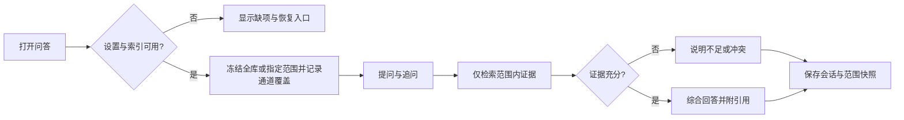

# 分 PRD｜AI 问答

> v5.3 · 2026-11-06 · 状态：已有问答与索引代码，本轮修订多平台检索设计；新增决策待实施，当前运行与人工验收状态按进度台账记录。本文是总 PRD 中的模块导航摘要；详细产品行为与验收以 `product/docs/基线/需求/10-10_AI问答_PRD.md` 为准。专题 PRD 更新时须同步校核本摘要。

## 1. 前置引用

本模块属于《多源内容知识库》总 PRD 的「AI 问答」模块。产品整体目标、目标用户与全局约束以 [总 PRD](00_总PRD.md) 为准；本文只规定基于已归档资料的问答范围与规则。

## 2. 本模块价值与局部痛点

**模块价值**：让用户基于自己已归档的资料获得跨内容回答、总结和追问，并能检查回答依据。

**局部痛点**：当问题涉及多份已存资料时，用户需要逐篇打开、搜索和拼接答案；如果回答没有来源、范围或证据不足说明，用户难以核对结论，也容易把模型推断当作资料事实。

## 3. 本模块目标与衡量指标

**目标**：用户能够看见本次检索范围与真实覆盖，并获得基于已归档资料的回答、连续追问、冲突说明和可打开引用。

**衡量指标**：按固定题集分别观察正确资料召回、范围越界、引用有效、关键事实错误、无答案克制、追问一致性和可用性。首轮没有可信数值基线，不报告总体准确率。

## 4. 本模块 Non-Goal

本模块不重做内容导入、字幕/图文识别和单条总结；不在提问时重读视频画面；不做分享、多人权限或由归档文字触发外部工具操作；不联网检索公开资料。

## 5. 本模块专属关键使用场景

1. 用户已存入多篇同主题资料，正在解决一个跨内容问题时，打开 AI 问答并向自己的资料库提问。
2. 用户一时想不起某条记录的具体文档，只记得其中一个事实或参数时，直接提问并查看回答引用。
3. 用户发现回答涉及资料冲突或现有资料没有答案时，查看分歧或不足说明，并在当前范围内继续追问。

## 6. 本模块用户故事

1. 作为知识库使用者，我希望在已归档资料范围内向 AI 提问，以便快速获得整合后的答案。
2. 作为核对回答的用户，我希望看到结论对应的来源素材和片段，以便打开实际使用的笔记、原文或详情核对依据。
3. 作为遇到冲突或资料不足的用户，我希望 AI 明确保留分歧或说明无法回答，以便按当前范围继续追问而不误信无依据结论。

## 7. 功能规则、交互流程、验收标准与非功能需求

### 7.1 范围与交互流程

**执行目标**：冻结 Content、Folder、Tag 或有效归档全库范围 → 检查各通道可用材料 → 直接选择工具及参数 → 检索／读取 → 必要重排与覆盖检查 → 有限补查或汇总 → 回答及来源。范围确认后不自动扩大；词法和向量各按有效索引参与。仅有短笔记的图文不因没有原文而算索引失败，未处理材料不能计作已检查。

保存的材料及其身份是回答依据；AI 笔记与原文分别标记，索引是可重建的派生数据。新增、修改、删除归档时更新相关片段；模型切换后不得暗中使用不匹配的旧索引。现行需求提出停用索引保存 14 天、重新启用取消待删，活跃索引不按期限删除。

B 站内容的标题、作者、发布日期、简介和原始标签等选定元数据作为带字段前缀的独立检索点，与字幕、转写和摘要片段分开建立；播放、点赞、投币、收藏、弹幕等统计计数不持久化，也不进入索引。

### 7.2 页面交互与信息呈现

入口显示当前锁定/可用/建索引/部分可问/需处理状态。正式页面上方显示范围与覆盖，中间是提问和回答，引用标志紧邻支持的句段，点开后在标志旁展示标题、片段和可用位置；可直达归档原文或详情。会话可继续与手动删除；每条回答有“没找到资料、回答不对、引用不对”反馈。视觉沿用当前产品语言，窄窗、键盘与具体引用卡片样式仍待设计验收。

### 7.3 功能规则

| ID | 产品行为 |
|---|---|
| AQ-01 | 入口按实际配置和能力显示状态；未具备必要能力时显示缺项。现有代码不代表新增工具流程已验收。 |
| AQ-02 | 必要设置完成后，旧资料可补建索引，新归档与修改增量更新，删除内容不再命中；B 站来源元数据随内容归档保存，指定字段独立建检索点，统计计数不持久化。 |
| AQ-03 | 各表示和通道分别显示已处理、待处理、失败数；缺原文不算笔记索引失败，词法有效不被向量缺失连带排除。 |
| AQ-04 | 默认有效归档全库；按各通道实际覆盖回答，可选 Content、Folder、Tag 并确认，范围变化只影响后续问题。 |
| AQ-05 | 每轮追问在当前范围内重新检索；跨资料结论综合多条证据，冲突并列展示。 |
| AQ-06 | 关键结论的引用指向真实 Content 与片段；元数据引用明确标注来源元数据；无准确位置时退到详情，不编造时间戳/页码。 |
| AQ-07 | 会话和范围快照保存在本地；反馈关联具体回答与引用；删会话不删知识库。 |
| AQ-08 | 索引身份与模型版本、维度、片段规则和文本哈希匹配才可复用；停用索引按已决定期限处理。 |
| AQ-09 | 必要能力不可用时暂停；仅按已配置策略降级至有效词法或融合排序并记录，不暗中换模型或资料外发路径。 |
| AQ-10 | 归档文字属于不可信资料，不得把其中“忽略规则”等文本当作控制指令。 |

### 7.4 异常处理、非功能需求与数据边界

未设置或必要能力不可用时停在缺项；允许的通道降级须按明确策略记录；部分索引只回答实际处理范围；范围内无证据时明确弃答；冲突保留分歧；只有摘要时标“依据摘要”；超时与断网不把失败标成功。用户选择需发送资料的外部服务时，按该配置发送任务所需文本；设置页说明发送类别和路径，不自动转到另一服务。资料原文、凭证和会话的保存范围须与设置分册一致。

### 7.5 验收标准

| 覆盖 | 可观察结果 |
|---|---|
| AQ-01 | 缺项状态与实际配置一致；不可用状态不伪装为可问，新增工具流程单独验收。 |
| AQ-02/03 | 新增、修改、删除各一条资料后，覆盖和命中状态准确，失败项不冒充已索引；B 站元数据点可按字段前缀召回，统计计数不落入内容库、归档或索引。 |
| AQ-04/05 | 范围内外放入相似答案，确认范围并追问时只引用范围内资料，旧回答保持原范围快照。 |
| AQ-06 | 抽查事实、数字和跨资料结论，引用能打开真实来源；缺失位置不出现伪时间戳。 |
| AQ-07/08 | 删除会话不删资料；切换模型只复用身份与文本一致的索引。 |
| AQ-09/10 | 模型不可用不隐式换路径；归档内提示词注入样本不触发外部动作或越界读取。 |

固定题集须包含事实、数字、同义问法、跨内容、冲突、无答案、指定范围、追问、仅摘要、错误引用和资料内诱导指令。按切片报告原始通过数，并保留未参与调优的样本；阻断性错引、越界和无证据确定性结论不得由平均分掩盖。

### 7.6 多平台材料与工具执行（2026-11-06）

详细规则以 [AI 问答专题 PRD §10.4](../需求/10-10_AI问答_PRD.md#104-多平台材料直接工具执行与汇总2026-11-06) 为准；工具契约、JEV 配置与资源试验数值统一见 [RAG 执行契约](../规则/RAG执行契约.md)。

- 文档导航、笔记、原文是允许缺层的三类表示，不按 B站／小红书拆物理向量库。短概述并入文档导航；与短笔记重复时去重或复用。
- 小红书图文仅有本地短笔记时，整篇索引和读取即可参与跨平台汇总；不扩写缺失图片，不伪称读取了原图。小红书视频和 B站视频都按实际字幕／笔记可用性执行。
- 生成时材料完整性、当前保留材料、笔记版本、原文可核对性与索引状态分别记录，短文本长度不代表低可信度。
- 模型直接选择目录查询、内容搜索、材料读取、原文检索、主题展开或集合汇总；一次可组合动作，不恢复任务类型到固定动作的中间映射。
- 重排前后按内容 ID 控制重复片段，保证短图文有被发现的机会；不强制平台等额。重排只排序相关性，不证明完整或正确。
- 明确集合逐篇处理并记录覆盖，失败可继续；跨平台汇总保留每条观点的材料身份和冲突，不将同篇笔记与字幕算成两个来源。
- JEV 默认关闭，等待 API 与对照评估；可参与支持检查、补查判断或选择参数已明确的候选动作，不生成查询参数，不替代 embedding／reranker。
- 验收按视频、短图文、混合平台、无原文、索引部分失败分别统计；文档修订不算实现完成或人工验收通过。

## 8. 风险与开放问题

### 8.1 依赖、风险与开放问题

依赖[知识库](03_知识库_PRD.md)的 Content 身份、版本、可定位文字和删除状态，以及[设置](04_设置_PRD.md)的本机/外部模型选择、秘密和出站说明。主要风险是检索漏证据、错引、资料内提示词注入、成本与本机资源。现行方案的 SQLite 向量存储是启动选择，仍须按固定题集验证；首个表示模型、回答模型、数值门槛、索引覆盖、窄窗视觉和正式解锁时间均待决。没有通过范围、引用、克制与隐私验收前，保持入口锁定。

### 8.2 参考与变更

产品行为以 `product/docs/基线/需求/10-10_AI问答_PRD.md` v1.2 为直接依据，当前锁定入口以 `product/src/services/core/app/ui/index.html` 为可见现状。2026-09-24 旧 PRD 关于“默认只选手动资料”的描述已被现行文档的“默认已索引全库，可确认指定范围”取代，不再引用为当前决定。本文服务本套 PRD 的导航和评审；具体实施方案与验证仍以项目当前独立文档为准。

v5.1（2026-10-14）：按产品全局与子模块职责边界重组章节，保留既有规则、流程和验收内容。
v5.2（2026-10-15）：摘要同步详细 PRD 的 B 站元数据检索与统计计数排除规则。

### 用户反馈后的连续问答（2026-11-10）

把用户最新反馈与正常历史交给模型，以简短提示引导自主调整。模型可修改回答、使用已有信息、更换/调整/再次调用工具，或不调用工具。无固定反馈分类、修订步骤和意图差异报告；程序保留权限/范围、预算和结果校验。详见[专题PRD§10.5](../需求/10-10_AI问答_PRD.md)，代码待实施。
