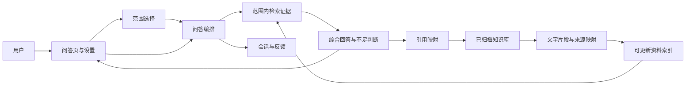
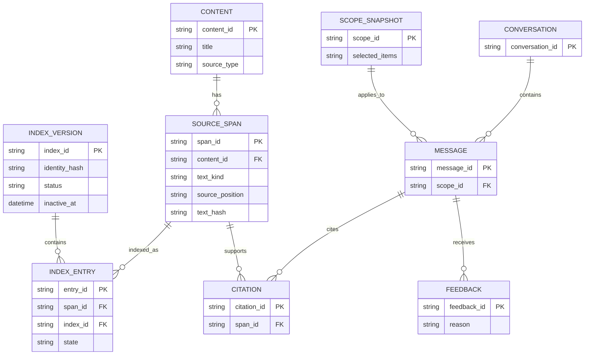
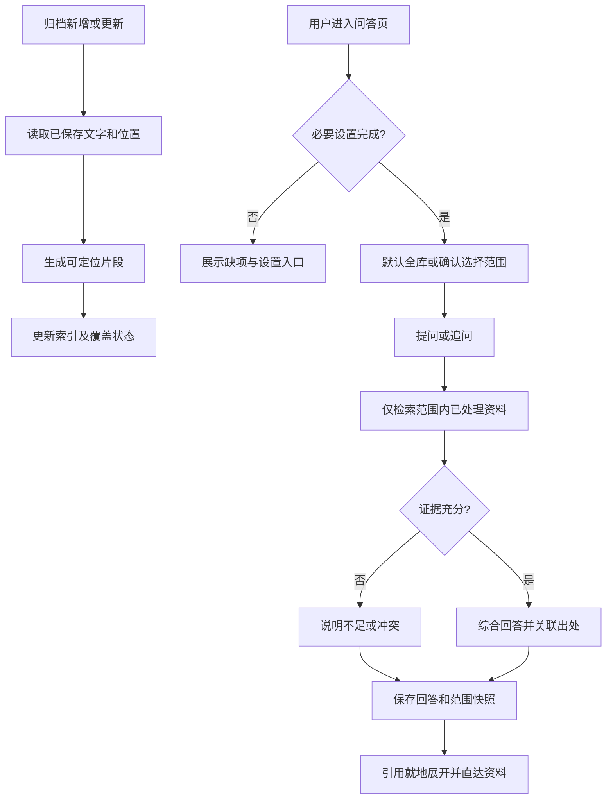
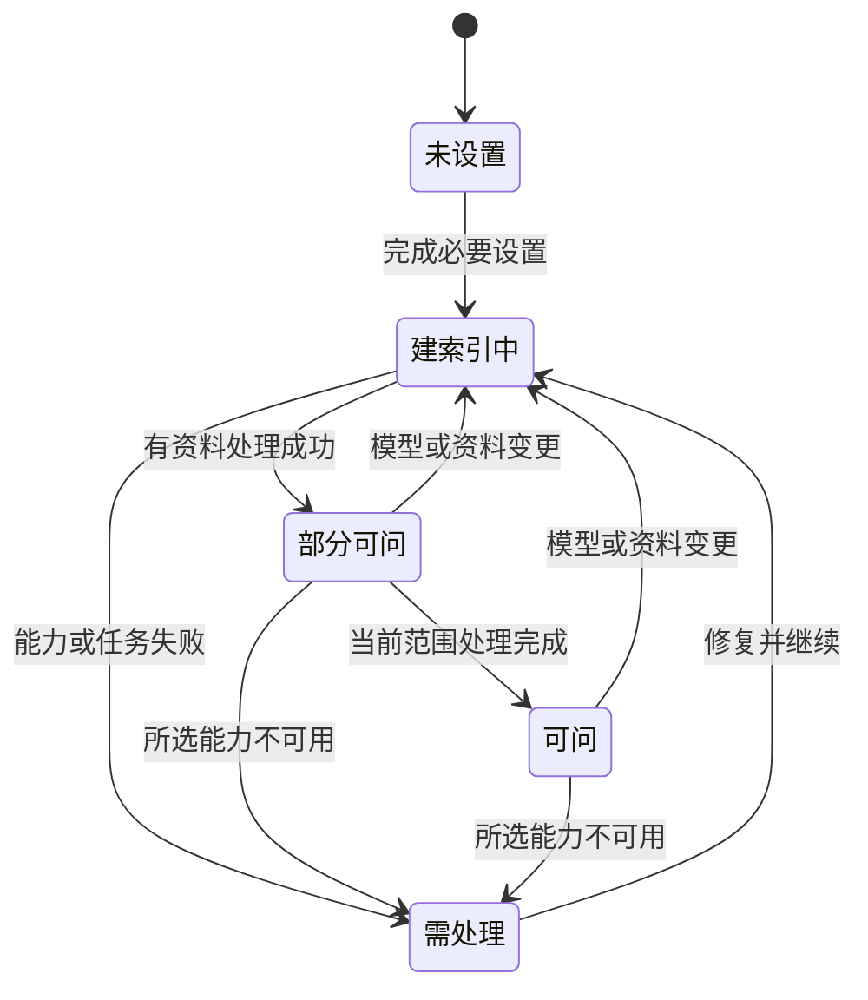
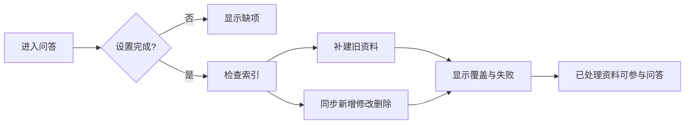
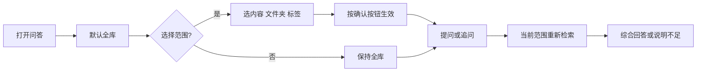
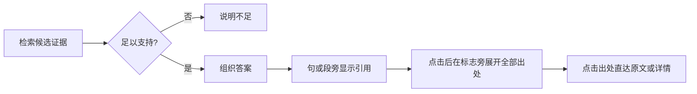
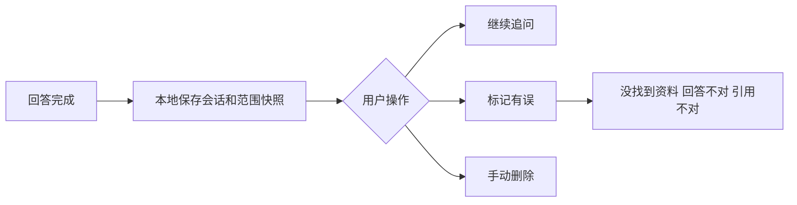
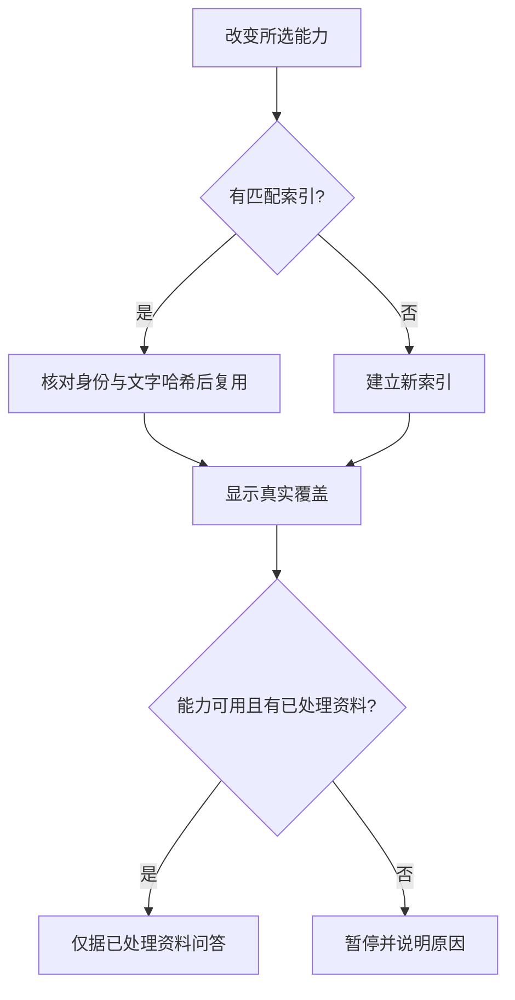

# PRD：知识库 AI 问答

> 本文固定已讨论的产品行为，区分当前启动选择与待验证事项。当前执行规则见 [RAG 执行契约](../规则/RAG执行契约.md)。已有问答与索引代码；2026-11-06 本轮只修订需求，新增决策待实施，运行与人工验收状态以当前进度台账为准。

调研依据：[普通用户知识库问答体验](../../过程/调研/专题研究/consumer-rag-knowledge-qa-ui/FINDINGS.md)、[知识库问答界面](../../过程/调研/专题研究/knowledge-base-ai-qa-ui/FINDINGS.md)、[RAG 工程方案](../../过程/调研/专题研究/ai-assisted-rag-engineering/FINDINGS.md)。研究内容供追溯，具体产品范围以本文为准。

## 产品定位与目标

| 项目 | 内容 |
|---|---|
| 产品类型 | 当前为个人本机知识库产品，暂不按企业多租户系统设计。[TODO: 确定是否商业化及目标客群] |
| 当前问题 | 用户已有大量归档内容，但回答一个问题仍需逐条打开、阅读、对照；已有问答实现仍需完善索引覆盖、工具调度与跨平台材料处理。 |
| 产品目标 | 用户用自然语言提问，产品在其归档资料中查找并**综合**相关内容，给出能核对来源的解答；支持连续追问、跨内容归纳、冲突说明和证据不足说明。 |
| 成功体验 | 用户能选择搜索范围，知道本次实际覆盖了哪些资料，理解答案依据，并直达实际保存的笔记、原文或内容详情。 |
| 本期边界 | 不重做已有导入、识别、总结；不在提问时重读视频画面；不做账号、分享和多人权限；不让归档文字触发外部工具操作。 |

**方法提示：**按“用户任务 → 可见行为 → 可核对证据”定义功能。模型、数据库和部署路径列入实施选择，不作为产品目标。

# 第10章 功能需求

## 10.1 产品框架概述

### 10.1.1 系统框架图

图示功能关系，不预设模型或存储的具体实现。

### 10.1.2 数据模型图

数据模型表达必须保持的关系，不规定最终表名。保存的材料及其身份是回答依据；AI 笔记与原始材料分别标记，索引是可重建的派生数据。

对于各平台内容，实际取得的来源元数据可形成独立的 `SOURCE_SPAN`，通过 `text_kind` 与字幕、转写、摘要等内容证据区分；元数据引用回到内容详情，不构造虚假的时间位置。

### 10.1.3 业务流程图

### 10.1.4 状态机图

“部分可问”按当前范围内各内容应有的索引表示计算；只有笔记的图文不因缺少原文而算索引失败。词法与向量分别报告有效覆盖，不得把部分检索称为搜索全库。切换模型后不暗中使用不匹配向量。

### 10.1.5 功能清单

| ID | 模块 | 可观察结果 |
|---|---|---|
| R1 | 开启与设置 | 必要设置完成才能问答，缺项可见 |
| R2–R3 | 资料准备 | 旧资料补建、新资料同步；真实覆盖与失败数可见 |
| R4 | 范围 | 默认全库；可选内容、文件夹、标签并按按钮确认 |
| R5 | 问答 | 回答事实及跨内容问题；追问重新检索；说明冲突与不足 |
| R6 | 引用 | 句／段旁标志就地展开，能回到来源 |
| R7 | 会话与反馈 | 本地保存、继续、手动删除；三类错误反馈 |
| R8–R9 | 索引维护 | 切换时匹配复用；停用索引保存 14 天；部分覆盖有提示 |
| R10–R11 | 可用性 | 所选能力不可用时暂停；设置状态与恢复入口清楚可见 |

## 10.2 产品需求详解

**方法提示：**各模块按“流程图 → 页面交互 → 业务规则”描述。具体颜色、字体和尺寸尚未确定，不从功能文案推断视觉稿。

### 10.2.1 开启与资料准备（R1–R3、R8–R9）

**页面交互：**入口显示可用状态；首次进入可见处理进度、已处理／待处理／失败数；只有摘要的来源标“依据摘要”。

**业务规则：**按实际材料建立文档导航、笔记、原文三类表示，允许缺层；笔记可以独立支撑其实际记载的观点，精确原话及原始细节须核对可用原文。存量自动补建，新归档增量处理，修改只更新受影响片段，删除后不再命中。问题向量随提问生成；资料向量可持久保存。索引身份包含提供方、确切模型／版本、维度、片段规则和内容／片段哈希。切回仅复用身份和文字都匹配的向量。停用旧索引保存 14 天，到期自动删除；重新启用则取消待删；活跃索引不按期限删除。新索引发布前核对覆盖，更新期间按有效表示报告可用范围；词法有效而向量缺失的资料仍可参加词法召回，失效向量不得使用，失败表示不计完成。不改写归档原文。

**B 站来源元数据：**内容库和可移植归档保存当前采集可获得的 B 站来源 JSON 快照，并单独保存 BVID、AID、作者 UID、原始简介、B 站原始标签和原始分 P 列表；每个分 P 内容保存自己的 P 序号、CID、分 P 标题和时长。多 P 内容按 BVID 关联视频级元数据，避免每个 P 重复保存整份快照。快照落盘前移除统计计数；播放、点赞、投币、收藏、弹幕等统计不写入内容库、归档或问答索引。B 站原始简介与产品生成的内容简介分开保存，B 站原始标签与用户维护的知识库标签分开保存。

**B 站元数据检索点：**问答索引将标题、作者、发布日期、B 站简介和原始标签等选定字段构造成独立检索点，并为每个检索点添加字段前缀，例如 `[标题]`、`[作者]`、`[发布日期]`、`[简介]`、`[B站原始标签]`。元数据检索点与字幕、转写和摘要片段分开建立；命中及引用标明“来源元数据”，并回到内容详情，不伪称为视频原话或带有音视频时间位置。缺失的来源字段不补造。

### 10.2.2 范围选择与提问（R4–R5）

**页面交互：**范围选择区及确认按钮清楚可见；提问区支持连续追问；答案旁显示本次范围和索引覆盖状态。

**业务规则：**未选择时默认有效归档全库，并分别展示各检索通道的实际可用范围；未处理材料不能被计为已检查。范围确认后不自动扩展；范围内无证据则说明不足。每轮追问根据新问题、对话上下文和当前范围重新检索。跨资料答案综合多条证据；资料冲突时并列展示说法与各自出处。范围变化只影响后续问题，历史答案和引用不变。

### 10.2.3 回答、引用与来源直达（R5–R6）

**页面交互与外观：**答案以段落呈现，引用标志贴近对应句／段；同段多个出处收在同一标志内，点击后在标志旁展开来源卡片，默认收起，不使用侧栏。卡片显示标题、片段及可用位置；冲突出处分开展示；摘要标“依据摘要”。[TODO: 确定引用标志样式、卡片宽度、动效、窄屏布局和键盘操作视觉稿]

**业务规则：**出处必须指向真实归档和片段。只有实际保存了准确位置，才跳到段落或时间点；否则跳内容详情，不能编造时间戳、页码或原文。关键结论需能核对实际使用的材料；仅有笔记时引用笔记，不声称原图或字幕已核验。同篇笔记与字幕不算两个独立来源。

### 10.2.4 会话与反馈（R7）

**页面交互：**会话列表可打开和继续；每条回答有“有误”入口及三类原因；对话有手动删除入口。[TODO: 确定会话列表位置、默认标题和删除确认文案]

**业务规则：**历史本地保存，不套用 14 天索引期限；反馈关联具体回答、范围和引用，供研发区分检索、生成及出处问题；删除对话不删除知识库或索引。

### 10.2.5 切换、覆盖与可用性（R8–R11）

**页面交互：**设置页分别显示资料索引能力、回答能力及状态；切换后显示覆盖、待处理和失败数。不可用时说明原因及恢复入口。[TODO: 确定设置字段、下载入口和状态文案]

**业务规则：**未完成必要设置不可开启。必要能力不可用时暂停；仅按预先配置的通道降级策略继续，并记录失败与降级，不更换模型或资料外发路径，不使用失效索引。用户应看到当前索引真实覆盖，不能把未处理资料算进回答范围。具体能力组合、发送规则与离线路径见第 11 章。

## 10.3 异常情况处理方案

| 场景 | 用户可见处理 | 数据与恢复规则 |
|---|---|---|
| 未设置或必要能力不可用 | 提示缺项／失败原因，暂停提问 | 仅执行预先配置的通道降级，不换模型或外发路径；修复后继续 |
| 某类索引未完成或失败 | 提示各通道覆盖及失败数，只回答实际取得材料 | 有效词法仍可参与；失败表示不计完成，缺原文不算失败 |
| 范围内无证据 | 明确说明资料不足 | 不扩大范围、不编造答案 |
| 来源互相矛盾 | 并列呈现说法与出处 | 各自保留真实来源 |
| 仅有摘要或原文位置缺失 | 标“依据摘要”或退到详情 | 不伪造原文、页码和时间点 |
| 归档更新或删除 | 更新／撤销相关索引 | 旧向量不用于新文字，删除内容不再命中 |
| 模型切换中断或切回 | 提示真实覆盖 | 仅复用匹配向量，活跃索引不误删 |
| 超时、断网或本机资源不足 | 说明失败和重试入口 | 保留归档与已存会话，不把失败标成功 |

## 10.4 多平台材料、直接工具执行与汇总（2026-11-06）

本节落实 R1～R25 决策；其中 R 编号属于本轮决策，不替换 §10.1.5 的既有功能编号。数值预算唯一维护于 [RAG 执行契约](../规则/RAG执行契约.md)，本 PRD 不复制数值。

| 编号 | 产品要求与验收行为 |
|---|---|
| QA-M01 | 按实际材料而非平台选择流程。B站及小红书视频有笔记／字幕时可分别检索；小红书图文仅保存笔记时仍可独立参加检索与汇总。 |
| QA-M02 | 文档导航层保存标题、短概述及有依据的主题表示；笔记层保存实际笔记块；原文层只保存可用字幕、正文、OCR。允许缺层，不按平台新建互相隔离的向量库。 |
| QA-M03 | 短笔记整篇作为一个语义块；概述与笔记重复时去重或复用表示，不因重复表示获得多次完整加分。不为增加向量数量扩写或猜测图片。 |
| QA-M04 | 分别保存生成时材料覆盖、当前保留材料、笔记来源及版本、原始材料可核对性、索引完成情况。M0／M1／M2 不等于当前原文是否保留。 |
| QA-M05 | 没有本地原图但已有可信生成过程的笔记可作为笔记依据；只有标题与链接则只能找回目录，不能生成内容事实。短笔记不能支持的尺寸、材质、原话必须说明不足。 |
| QA-M06 | 保留原问题；将对象、范围、主题、覆盖及输出要求合并为工具参数。仅在指代歧义会改变对象时澄清，不先强制选择唯一问题类型。改写不得添加条件或把全部改成前若干条。 |
| QA-M07 | 工具分别承担目录查询、相关内容搜索、指定材料读取、原始证据检索、主题关联展开、明确集合汇总。一个工具可使用多个索引，模型不选择数据库或 BM25 权重。 |
| QA-M08 | 跨平台按内容 ID 聚合候选、控制同篇片段贡献，修正先截断后按文章丢弃导致覆盖不足的问题。无平台要求时不强制平均分配；明确比较双方时记录各自覆盖。 |
| QA-M09 | 完整集合汇总冻结集合及版本，逐篇记录已处理、无关、缺失、失败、未处理，分批提取再合并；可取消和继续。只检索到部分主题候选时不得声称找全或准确总数。 |
| QA-M10 | 相关性重排不证明事实正确或集合完整。单篇完整读取可绕过重排；必须处理的集合成员不因分数低而被静默删除。 |
| QA-M11 | JEV 默认为关闭，待 API 和中文样本评估；优先试验答复点支持和补查判断，必要时选择参数已明确的合法动作。材料存在性、范围合法性和计数由程序判断。 |
| QA-M12 | 生成答案保留观点对应内容与材料身份；跨平台合并观点不抹去冲突，同篇笔记与字幕不算独立来源。缺原文不伪造时间戳、原图判断或已核验声明。 |
| QA-M13 | 索引覆盖、召回、分组、重排和最终上下文分别记录数量与失败原因。词法有效不应被向量缺失连带排除；无匹配与调用失败必须区分。 |

验收须单独覆盖小红书短笔记、跨平台同主题、明确集合完整汇总、原文不可用、长视频片段挤占短笔记、向量部分失败但词法有效。自动检查记录证据，交互和回答质量标为待人工验收；未经用户确认不得标为已解决。

# 第11章 实施选择、阶段与验证

## 11.1 当前选择及选择前提

**方法提示：**启动选择是可检验的工程决定；用同资料、同题集比较后再固化。以下实现路径不改变第 10 章的功能要求。

| 项目 | 当前启动选择及原因 | 其他方案优点／代价 | 后续改选条件 |
|---|---|---|---|
| 资料读取 | 复用现有归档正文、字幕、OCR、摘要；资料已入库，先盘点真实位置 | Docling 等可补复杂格式，但增加解析与定位链路 | 出现实际读取缺口，再测抽取完整度和定位改善 |
| 接口与关系数据 | 沿用现有 FastAPI＋SQLAlchemy＋SQLite，减少迁移 | 其他后端／关系库可支持更大部署，但迁移成本高 | 实际用户规模、运维或性能证据要求改变时 |
| 向量库 | **当前选择 SQLite**：沿用本机数据部署，降低启动和备份复杂度；需验证 FTS5／sqlite-vec 的适配 | Qdrant 向量能力完整、过滤与扩展更专门；需独立服务及跨库同步／备份 | 固定向量和片段对照正确性、范围过滤、p95、重启恢复、切回及 14 天清理；未达门槛改选 |
| RAG 编排 | 先在现有后端直接编排可测流程，便于控制来源、范围、增量和期限 | LlamaIndex 可加快常见流程拼装；默认行为和抽象可能增加排错成本 | 固定模型和存储后比较功能等价、维护量与调试 |
| 检索 | 文档导航、笔记、原文按实际材料分别建立；词法与向量独立召回、按文章融合，正式接入有预算的重排 | 单篇读取可绕过重排；集合完整汇总不能用 Top-K 淘汰必处理文章 | 先排查索引覆盖，再对照文章召回、重排增益、短笔记覆盖、延迟与费用 |
| 表示模型 | 当前 RAG 首轮基线复用代码已有硅基流动 Qwen/Qwen3-Embedding-8B、1024 维；确切运行配置和接口可用性待核实；本机路径再评估 Qwen3-Embedding-0.6B、BGE-M3 | 本机可离线但需资源；API 部署轻但依赖网络与费用 | 真实中文题 Recall@k、索引／查询耗时、资源与成本；不能把代码型号当作已验证部署 |
| 回答模型 | 复用用户选择的生成模型；查询理解、必要改写与工具参数生成合并规划，依据实际材料回答 | JEV 可替换局部判断，但不生成工具参数、检索词或最终答案 | 固定材料评估事实、综合、拒答、引用及成本 |
| 路由判断 | 目标为直接选择工具并生成参数，取消 task／granularity 分类到动作的中间映射；程序控制范围和预算 | JEV 仅在参数已明确的候选动作选择、答复点支持检查、补查判断中有条件参与；默认关闭，API 待用户提供 | 同题集评估工具及参数正确性、JEV 判断错误、p50／p95 和费用；不预先宣称其速度或中文效果 |

SQLite 是**当前启动选择**，不把未经实验的向量扩展、版本或性能写成已验证结论。用户原称“Circle”，已确认其指 SQLite。

2026-11-06 实施设计修订：[RAG 执行契约](../规则/RAG执行契约.md)统一维护工具输入输出、材料身份、重排与资源初值。模型直接提出合法工具动作，程序校验范围、参数、计数与预算；仅缺口明确且预算允许时补查。候选／正式检索细词独立于用户标签，规范主题与现有存储继续复用。新增决策不代表实现或效果已验证。

## 11.2 分阶段实现与转换前提

| 阶段 | 采用路径 | 新增目标 | 转换前提 |
|---|---|---|---|
| M1 · 资料与检索基线 | 盘点归档；构建片段、来源映射、回填和增量索引；做候选对照 | 能找回真实证据，知道覆盖与缺口 | 固定题集、失效归因和基线完成；产品负责人确认数值门槛 |
| M2 · 首个可用问答 | 先以可配置外部回答服务打通完整用户体验；索引能力按 M1 结果选用 | 范围、跨资料回答、追问、引用、会话及反馈可用 | 题集达到门槛，人工核对代表答案与交互 |
| M3 · 完整本机路径 | 增加本机表示与回答能力，支持独立选择、切回复用和期限清理 | 首次取得资源后，断网完成资料处理与问答 | 当前开发者电脑实测质量、速度、资源和故障恢复 |

M1 的单条事实题是**研发诊断**，不是用户可见的“单内容模式”。M2 起的产品仍要综合用户归档回答问题。

实施配置：资料表示与回答能力分别提供本机／外部选择，允许混合组合；用户选用需要发送资料的外部服务，即按该配置发送任务所需文本，不另加发送确认。所选配置不可用时不自动转到其他模型或另一发送路径；已明确配置的词法检索或融合排序降级可执行，必须记录实际通道与覆盖。M3 首次下载所需模型后，在当前开发者电脑断网验证新增资料处理、检索、回答和出处查看。

## 11.3 对照验证与变更回归

| 对照层 | 固定条件 | 比较与重测 |
|---|---|---|
| 资料／切片 | 同批归档、可核对来源 | 抽取完整、片段边界、真实定位；读取或切片变化时重测 |
| B 站元数据检索 | 含不同标题、作者、发布日期、简介和标签的 B 站条目 | 验证带字段前缀的独立元数据点可召回、引用标明来源元数据；统计计数不在内容库、归档和索引中 |
| 检索／模型 | 同题集、范围、top-k | Recall@5／@10、跨内容全部证据找回、越界和时延；表示模型、融合或重排变化时重测 |
| 库／框架 | 同向量、片段和过滤条件 | 结果等价、增删改、重启恢复、切回及清理；库或框架变化时重测 |
| 回答模型 | 复用用户选择的生成模型；查询理解、必要改写与工具参数生成合并规划，依据实际材料回答 | JEV 可替换局部判断，但不生成工具参数、检索词或最终答案 | 固定材料评估事实、综合、拒答、引用及成本 |
| 工具与局部判断 | 同题集、同范围、同索引 | 工具选择、参数、复合需求覆盖、补查收益与错误；JEV 启用前旁路对照支持判断及补查判断，不将置信度当正确性 |
| 端到端 | 固定真实题卡和资料快照 | 用户可用性、出处直达、覆盖提示、p50／p95；影响结果的变更时重测 |

题集覆盖事实、数字、同义问法、跨内容、冲突、无答案、指定范围、追问和仅摘要；逐题保存正确资料 ID 与位置，留出不参与调参的题。首轮题集规模、各类最低通过数、阻断错误及执行预算已定义于 [执行契约 §10–12](../规则/RAG执行契约.md#12-发布前验证标准-r6)，属于 AI 补全的待验证标准；M1 后按真实题集和实机结果版本化修正。未实际通过前不能宣称 M2 已验收。

## 11.4 新品目标、外观与未决项

若“新品目标”指本功能作为新产品的独立定位，目前尚无足够信息：[TODO: 确认是现有产品新增功能，还是独立新品；若为新品，补目标用户、渠道与商业目标]。当前按**现有产品新增功能**撰写。

外观仅固定信息层级：范围和覆盖可见、答案突出、引用贴近文字、出处就地展开、异常有下一步。延续现有产品视觉语言。[TODO: 提供问答页、范围区、引用卡片、会话列表、设置及异常态的视觉稿或设计规范；确定窄屏与无障碍样式]

其余待决／待验证：所选模型实际身份、版本与能力核实、本机模型选择、当前开发者电脑配置、现有归档的位置字段覆盖、执行契约初值在 M1 后的实机质量及性能、商业化定位。未决项不改写第 10 章已确定的产品行为。

## 版本与参考

| 版本 | 日期 | 内容 |
|---|---|---|
| 1.0 | 2026-10-10 | 初版：已选行为与三阶段 |
| 1.1 | 2026-10-10 | 按第 10 章结构改写，目标改为结合归档综合解答，SQLite 标为当前选择，补图、异常及 TODO |
| 1.2 | 2026-10-15 | 增加 B 站来源元数据持久化、独立检索点和统计计数排除规则 |
| 1.3 | 2026-10-31 | 链接 RAG 执行契约：LLM 任务／粒度及工具计划、逐点证据标准、独立细词、强度适配和首轮验收初值；未实施 |
| 1.4 | 2026-11-02 | 登记路由判断的三种候选（模型字段／专用决策模型／embedding 相似度）及对应验证项；三种方案均为待实测，不改变第 10 章行为 |
| 1.6 | 2026-11-06 | 按 R1～R25 修订直接工具执行、多平台缺层索引、短笔记、重排与集合汇总；JEV 有条件参与；本轮仅文档修订，待实现与验收 |
| 1.5 | 2026-11-02 | 路由移除「穷尽」键：不再自动触发逐条语义扫描，改由正常混合检索回答；同步 RAG 执行契约 |

技术参考：[SQLite FTS5](https://www.sqlite.org/fts5.html)、[sqlite-vec](https://github.com/asg017/sqlite-vec)、[Qdrant](https://qdrant.tech/documentation/overview/)、[LlamaIndex](https://developers.llamaindex.ai/python/framework/getting_started/concepts/)、[Qwen3 Embedding](https://huggingface.co/Qwen/Qwen3-Embedding-0.6B)、[BGE-M3](https://huggingface.co/BAAI/bge-m3)。

### 2026-11-07 工程准备补充

切片目标、工具schema、预算计量及迁移发布细则更新至[执行契约v3.1](../规则/RAG执行契约.md)。1000/200按UTF-8字节并保持字符完整；短笔记是否单块按字节上限判断，不按Token阈值跨过硬限制。默认库基线、实施步骤及未决验证见[本轮方案](../../过程/2026-11/11-06_跨平台知识库检索与工具调度_解决方案.md)。这是文档设计，未完成代码切换。

## 10.5 用户反馈后的自主调整（2026-11-10）

用户最新消息和正常会话历史直接进入模型。通过简短提示让模型根据反馈重新理解需求，自行决定修改/解释回答、使用已有信息、选择或调整工具，或必要时澄清。无需调用工具时允许直接回答，不新增反馈类型分类、固定修订方案或专门意图报告字段。

QA-F01：上下文包含相关历史回答和真实工具结果，不只包含旧问题。QA-F02：支持零个或多个合法工具调用。QA-F03：同一工具可再次使用，不机械重复旧理解。QA-F04：权限、范围、预算、材料有效性及引用仍由程序校验。QA-F05：以实际反馈样例检验自主调整能力，不规定每种话术必选某个动作。

执行提示及边界唯一见[执行契约§10.4](../规则/RAG执行契约.md)。本节替代先前的固定反馈场景表、强制意图差异字段及专门跨轮去重设计，代码待实施。

### 2026-11-10 工具优先代码落点

正式问答已移除首轮分类执行，模型直接选择8项已注册只读工具或零工具回答。用户反馈沿正常对话进入同一执行循环；不存在固定修订类型。实际schema、当前预算与保留的后续目标以执行契约§14为准。自动检查与人工状态见[实施方案](../../过程/2026-11/11-10_工具优先问答执行_解决方案.md)。
