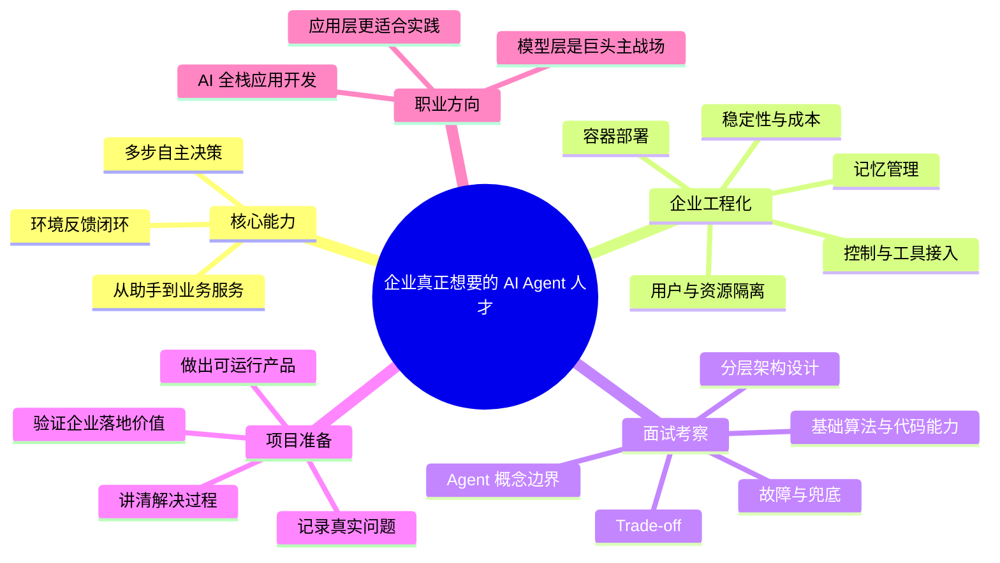

# 视频总结

## 视频信息

- 标题：面了6个AI Agent候选人，我发现企业真正想要的人长这样
- UP 主：海云日记
- 时长：约 4 分 59 秒
- 来源：[哔哩哔哩视频](https://www.bilibili.com/video/BV14oL866EaZ/)

## 视频总结

### 一句话总结

企业招聘 AI Agent 应用人才时，真正看重的不是能否背诵模型和框架名词，而是能否把大模型做成稳定、可控、可交付的企业应用，并清楚解释设计取舍与故障处理。

### 关键观点

1. Agent 开发的核心是多步自主决策、根据环境反馈持续执行并形成闭环；单次检索或单轮对话通常还只是聊天机器人或检索应用。
2. 企业级 Agent 的差异在工程化：控制能力、环境隔离、记忆、容器部署、稳定性和成本都要纳入设计。
3. 面试官会通过架构设计题和故障题判断候选人是否真正做过系统，而不是只会复述概念。
4. 讲清楚 Trade-off 很重要，例如准确率、延迟、成本、上下文长度和用户体验之间的权衡。
5. 常见故障不能只说“重试”：工具调用失败、上下文或参数异常、路由偏差等情况都应有拒绝、降级和兜底策略。
6. 模型底层训练和推理创新更接近大公司的主战场；普通开发者更容易在应用层做出可验证、可落地的产品。

### 主要结论

准备 AI Agent 面试时，应先做出一个能运行的项目，再能说明为什么做、怎么做、遇到什么问题以及如何解决。项目最好从个人助手进一步思考如何满足企业场景，包括用户隔离、资源隔离、稳定性、成本和交付方式。

## 内容详情

### 1. 企业需要的是“生产力化”的 Agent（00:00-00:32）

视频以企业 AI 平台招聘和面试经历开场。作者认为，很多候选人把 Agent 开发理解成算法题，忽略了企业真正关心的是把大模型转化为生产力：从电脑上的助手，发展为能够接入业务、执行操作并长期运行的服务。

作者提到的企业化能力包括控制、环境隔离、记忆和容器部署。核心区别是系统能否在真实业务流程中稳定跑起来，而不只是演示一次对话。

### 2. 面试首先考察对 Agent 的理解（00:32-01:17）

视频提到的典型问题包括：Bot 加插件是否算 Agent，检索增强加插件是否算 Agent，以及什么才是 Agent 的核心。

作者给出的判断标准是：

- 是否具备多步自主决策；
- 是否能根据环境或工具返回结果调整下一步；
- 是否形成任务执行的反馈闭环。

单次检索得到答案，或只完成一次固定调用，更接近聊天机器人或普通检索应用。面试时，与其背诵一堆名词，不如能够画出企业 Agent 的分层架构，并说明接入层、对话管理、Agent 核心、工具层和基础设施之间如何协作。

### 3. 企业架构关注隔离、记忆、成本和稳定性（01:17-01:49）

针对企业级 Agent，作者强调需要回答“怎么设计”，而不是只说“用了什么框架”。讨论方向包括：短期与长期记忆如何组织、不同环境如何隔离、工具如何接入，以及容器化部署如何支持稳定运行。

视频还强调模型选择不能只追求最大或最新。企业通常要在能力、速度、成本和用户偏好之间取平衡；稳定性和长期维护成本，往往比一次演示效果更重要。

### 4. 用 Trade-off 展示工程判断力（01:49-02:17）

作者认为，能够结合具体例子讲清楚 Trade-off，面试表现会明显更好。某种方案可能提高准确率或效果，但同时增加上下文消耗、延迟、成本或表达负担，线上系统未必承受得住。

因此，回答设计问题时应同时说明：为什么选择该方案、它解决了什么问题、付出了什么代价，以及在什么业务条件下会换成另一种方案。

### 5. 重点追问失败处理和兜底策略（02:17-02:38）

视频举出的 Agent 常见失败方向包括工具调用失败、上下文或参数异常，以及调用偏差等。好的候选人不应止步于列举故障，还要为每种故障说明拒绝策略、重试或降级策略、结果校验和最终兜底方式。

作者将“能否解决问题”视为重要判断标准。企业系统必须考虑失败是常态，而不是假设每次模型调用和工具调用都会成功。

### 6. 应用层是更现实的机会（02:38-03:25）

作者提到，电商等大厂的 Agent 应用岗位可能给出较高待遇，但模型层本身需要大量资源和专业积累，参与门槛很高，岗位也相对集中。相比之下，应用层更适合普通开发者积累成果。

作者特别认可一种项目思路：把一个个人助手改造成企业服务，并能解释它如何适配企业流程。很多人会做个人项目，却没有进一步思考如何让项目服务组织、用户和业务目标；这种“从能用到可交付”的思考本身就是稀缺能力。

### 7. 面试和项目准备建议（03:25-04:17）

作者将当前 AI 应用能力概括为两部分：算法或推理创新，以及工程落地与稳定运行。对大多数应用开发者，更应优先证明后者。

建议分三步：

1. 先做出一个确实能运行的东西，并记录为什么做、怎么做、遇到了什么问题、如何解决。
2. 面试时主动讲真实问题和改进过程，让面试官能够继续深挖，而不是只展示功能列表。
3. 保持基础技术能力，算法或代码题仍可能成为筛选环节；应用项目不能替代基本功。

视频后段还提到用户隔离、资源隔离、基础设施、容器和应用架构等企业化考察点，并认为“能把东西做出来”是最有说服力的验证。

### 8. 收束观点（04:17-04:54）

视频最后的核心判断是：模型是巨头的战场，应用才是多数开发者可以争取的战场。与其追求过高、过于宏大的目标，不如完成一个从前端、后端到 AI 能力接入的完整应用，并能说明它如何解决真实问题。

## 内容思维导图

## 补充信息

- 内容来源：视频音频 ASR 转写；页面未发现可用官方字幕轨道。
- 完整性：中高。音频覆盖约 298 秒，转写覆盖全片。
- 可信度：中等。中文语音识别整体可读，但少数 AI 专业缩写、数字和专有名词存在误识别；总结已优先采用上下文能够确认的含义。
- 限制：本总结未分析画面、字幕画面、图表或视频帧，因此不包含视觉信息。
