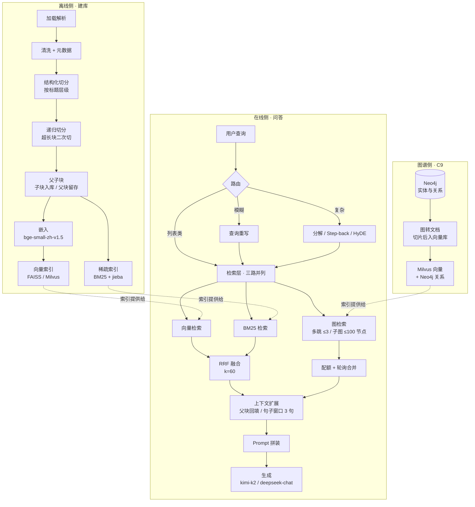
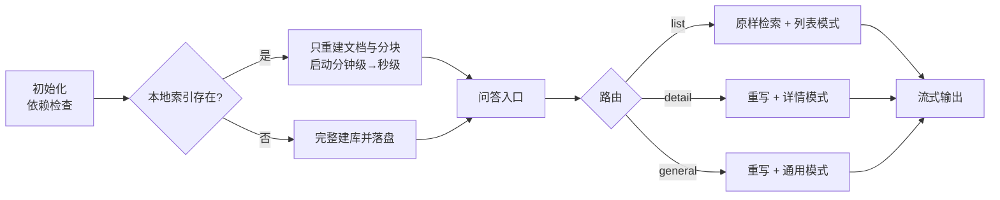

# RAG 底座与检索实现调研（All-in-RAG）

> 调研对象：Datawhale《All-in-RAG》十章教程，含两个完整实战项目（C8 菜谱问答、C9 图谱增强版）。  
> 本文只回答三件事：**它由哪几层组成、每层用了什么模型、结果怎么流动**。不写操作步骤，不贴参数表以外的代码。

## 0. 三条结论

1. **RAG 的主力是"规则 + 向量检索"，不是全流程调 LLM。** 生成模型只出现在四个位置：查询路由、查询重写、最终生成、图检索的查询分析。
2. **切片的正确目标是"检索用小块、生成用大块"。** 教程用父子块和句子窗口两种方式实现同一件事，这是全文最值得抄的设计。
3. **多路召回已做到三路并列（向量 / BM25 / 图谱），融合只用 RRF 和配额合并。** 全程没有引入 cross-encoder 重排模型——这条路是"先把召回做对，再谈重排"。

## 1. RAG 的逻辑

一句话：**让模型开卷考试**。先把外部知识切成块存进索引，提问时先取回相关块，再让 LLM 在取回的这几段里作答。

由此分出两侧，所有工程都落在这条线上：

- **离线侧**：加载 → 清洗 → 切片 → 嵌入 → 索引。一次建好、可缓存、可重建。
- **在线侧**：查询 → 路由 → 检索 → 融合 → 扩展 → 生成。每次提问都要跑一遍。

三档演进（教程表 1-1）：初级（索引-检索-生成）→ 高级（检索前后各加优化）→ 模块化（积木式可编排）。C8 与 C9 落在"高级偏模块化"，即**主链固定、可选环节可插拔**。

## 2. 整体框架

三个入口汇到一条问答链：离线建库、图谱建库（C9 独有）、在线问答。

读这张图的三个要点：

- **只有一条主链**，路由是插在"查询"和"检索"之间的分叉点，它的上一步是用户查询，下一步是检索；改写的产物直接替换原查询去检索，不回流到别处。
- **检索层内部是并列不是串联**：向量、BM25、图三条路同时走，各自出候选，之后才汇合。
- **图谱是支线**：它既是第三个建库入口（Neo4j 里的关系转成文档再切片入向量库），也是第三条并列检索路径。

## 3. 框架里的模型（每一环挂什么）

| 环节        | 用什么                                                                      | 是不是模型        | 换掉它的代价            |
| --------- | ------------------------------------------------------------------------ | ------------ | ----------------- |
| 解析        | Unstructured（规则，非模型）；MinerU（版面模型 + OCR）；PaddleOCR；PyMuPDF4LLM / Marker   | 部分是          | 换解析器 ≈ 重做清洗规则     |
| **结构化切分** | Markdown 标题分级、Unstructured `by_title`                                    | **不是模型**，纯规则 | 无成本，但要求原文本身有层级    |
| **语义切分**  | SemanticChunker：算相邻句嵌入相似度找断点                                             | 是，复用嵌入模型     | 慢，只在主题跳跃明显时值得用    |
| **嵌入**    | `bge-small-zh-v1.5`（512 维 / 上下文 512 token）；`bge-m3`（dense 1024 + sparse） | 是            | **换模型必须全量重建索引**   |
| 稀疏检索      | BM25 + jieba 分词 + 停用词                                                    | 不是模型         | 无成本               |
| 融合 / 重排   | RRF（k=60）；图结果用配额 + 轮询                                                    | 不是模型         | 无成本，参数极少          |
| 生成        | `kimi-k2-0711-preview`（temp 0.1）；`deepseek-chat`（temp 0，JSON 输出）         | 是            | 换模型需重调 Prompt 与模式 |
| 图谱        | Neo4j 存关系 + Milvus 存向量                                                   | 不是模型         | 换语料要重建图谱          |

一句话：**真正挂模型的只有解析、语义切分、嵌入、生成四环**；结构切分、BM25、融合、图谱全是确定性规则。这是整套框架成本可控的根本原因。

这也回答了"模型是不是框架的一环"——**是**。上表每一行都对应框架图上的一个方块，换模型等于换方块，不是换参数。

**模型选择的三条判据**

- 嵌入模型先看**上下文窗口**，再看向量维度：窗口直接决定块上限（512 token），超了是**静默截断**，不报错、只是召回变差。
- 语言必须明确支持中文。教程默认 BGE 系列；英文默认小模型在中文语料上会明显退化。
- 榜单只做初筛。MTEB 排名之后必须自建私有评测集（真实问题 + 应该被召回的那一块）。

## 4. 项目流程（模块怎么串、在哪分叉、哪一步可跳过）

C8 的主链是四段：**初始化 → 建库 → 问答 → 输出**。真正值得记的是三个分叉点。

三个分叉点各自的作用：

1. **索引是否命中** —— 命中就整条离线链跳过。这是"建库"和"问答"之间唯一的分支。
2. **路由结果** —— 同时决定两件事：要不要重写查询、用哪套生成 Prompt（list / detail / general 三种模式）。
3. **查询复杂度**（仅 C9）—— 决定走不走图检索。

C9 在问答前多一层，且降级顺序是硬约束：

也就是说：**图这条路是增强项，不是依赖项**。它挂了要能退回纯向量+BM25，这条降级链比图本身更值得参考。

## 5. LLM 用在哪几步

只列位置：

- **查询路由** —— 判断 list / detail / general
- **查询重写** —— 模糊问题具体化（列表类不改）
- **多查询分解 / Step-back / HyDE** —— 可选，开了就是一次提问变多次调用
- **图检索的查询分析** —— 判复杂度与关系密度，**失败降级为关键词规则**
- **最终生成**
- **评估** —— RAGAS / TruLens 的 LLM-as-judge

其余环节不调生成模型。判断依据只有一条：**需要理解意图、需要写字的地方才上 LLM，其余越确定越好。**

## 6. 检索逻辑

**第一层：三路并列，一次查询同时走**

- 向量检索 —— 管语义相近（"简单易做的菜"）
- BM25 检索 —— 管字面命中（"宫保鸡丁""爆炒"）
- 图检索 —— 管跨实体的多跳关系（A 用了 B，B 属于 C）

**第二层：融合是两套，不是一个**

| 组合         | 融合方式          | 为什么不一样                                 |
| ---------- | ------------- | -------------------------------------- |
| 向量 + BM25  | **RRF**，k=60  | 两路是同质结果、只是分数量纲不同；RRF 只吃名次不吃分数，天然免疫尺度差异 |
| 图结果 + 传统结果 | **配额 + 轮询合并** | 两路是异质结果，必须都给位置：各取一半、图优先、按内容哈希去重        |

分清这一点很关键：**RRF 解决"同质结果怎么排"，配额合并解决"异质结果怎么都留得下"**。用 RRF 吞掉图结果，会把它压没。

**第三层：检索之后还有两步，顺序不能反**

1. **上下文扩展**：父子块用 parent_id 回填整篇；句子窗口用元数据换回前后 3 句。
2. **元数据过滤**：先过滤再检索，且候选数放大 3 倍再截断，否则过滤完不够用。

**查询侧的可选优化，按代价从低到高**：路由 → 重写 → 分解 → Step-back → HyDE。每加一级就多一次 LLM 调用，首字延迟和费用同步上涨。

## 7. 两处核心设计（不是可选优化）

**① 结构切分 + 递归切分，是两级串联不是二选一**

先按标题切成带元数据的逻辑块（块上带标题路径），块内超长再套递归字符切分，子块**继承标题路径**。顺序反了就是"先切碎再猜层级"，元数据在这一步就丢了。

**② 父子块：子块检索、父块生成**

C8 的父块是整篇菜谱（约 700 字），子块是 `## 必备原料` 这样的章节。教程给的理由很直接：**整篇拿去做向量检索时，具体问题在全文里占比太小，很可能检索不到。**

两个数值界限：块上限由嵌入模型上下文决定（`bge-small-zh-v1.5` = 512 token）；C9 的字符口径是 500 / overlap 50。

## 8. 数据清洗与加载（只说做什么，举例）

- **产物必须是"正文 + 元数据"两件。** 来源、页码、标题路径都要留住——元数据是后面过滤和回填的唯一依据。
- **选解析器看文档形态，不看精度排名**：
  - Markdown / 网页 → Unstructured（能识别 Title / NarrativeText / ListItem / Table / Header / Footer 等 16 类元素）
  - 扫描件、复杂版面 PDF → MinerU（版面模型 + OCR）或 PaddleOCR
  - 数字版 PDF → PyMuPDF4LLM / Marker 转 Markdown
  - 法律合同、学术论文 → LlamaParse（精度优先，按页计费）
- **结构信息在加载阶段就要留住。** Unstructured 的 `by_title` 把 Title 当章节边界，等价于 MarkdownHeaderTextSplitter；等到切片时再猜层级，已经损失了。

## 9. 对本项目的可用结论

1. **视频转写天然是父子块结构**：一条视频 = 父文档，按字幕段落切子块，命中后回填整条转写。与 C8 同构，不用重新设计。
2. **中文上 BM25 前必须先分词**（jieba + 停用词），否则这一路等于白加。
3. **扩容顺序是 三路并列 → 融合 → 扩展**，不是先上重排模型。教程全程没有 cross-encoder。
4. **索引可缓存可重建，正文不可。** 判缓存失效的只有两件事：切片参数变过、嵌入模型变过。
5. **图检索必须留降级路径。** 三级降级链比图本身更值得参考。
6. **评估要自建小样本集**；本项目的 269 条小红书 + 64 条视频转写可直接当语料。

## 10. 局限与内部不一致

- **无评测数值**：除句子窗口的定性对比外，没有 Recall/NDCG 一类指标，"效果更好"多为经验判断。
- **一处代码与流程图不一致**：查询重写的流程图写"general 才重写"，代码是"list 不改、其余都改"。以代码为准。
- **规模偏小**：C8 约 300 篇 Markdown、单篇约 700 字；C9 图节点数十到数百级。没有增量更新、多用户、权限、审计的讨论。
- **索引优化缺量化**：给了做法（句子窗口、结构化索引、递归检索），没给同语料下的性能与内存数据。

## 11. 与另一份归档的分工

同一教程的查询构建、Text2SQL、重构分发、重排模型与评测，已由 [Datawhale\_RAG查询策略与评测调研](Datawhale_RAG查询策略与评测调研.md)（第 4、6 章为主）覆盖。本文覆盖第 1、2、3、8、9 章，即**框架、模型落位、清洗、切片、索引与三路检索**。两文互补，不重复抄同一批参数。

## 12. 来源

1. 项目 README（章节结构与定位）：<https://github.com/datawhalechina/all-in-rag>
2. 第 1 章 RAG 简介（定义、三档演进、选型次序）：`docs/chapter1/01_RAG_intro.md`
3. 第 2 章 数据加载（加载器对比、Unstructured 元素）：`docs/chapter2/04_data_load.md`
4. 第 2 章 文本分块（四种策略、参数）：`docs/chapter2/05_text_chunking.md`
5. 第 3 章 向量嵌入（BGE、MTEB、选型维度）：`docs/chapter3/06_vector_embedding.md`
6. 第 3 章 索引优化（句子窗口、结构化/递归检索）：`docs/chapter3/10_index_optimization.md`
7. 第 4 章 混合检索（稀疏/稠密、RRF、Milvus）：`docs/chapter4/11_hybrid_search.md`
8. 第 4 章 查询重构与分发（重写、分解、Step-back、HyDE、路由）：`docs/chapter4/14_query_rewriting.md`
9. 第 8 章 项目实战四节（架构、数据准备、索引检索、生成整合）：`docs/chapter8/01_env_architecture.md` 等
10. 第 9 章 图 RAG 架构（Neo4j + Milvus、路由阈值、降级）：`docs/chapter9/01_graph_rag_architecture.md`

在线站点：<https://datawhalechina.github.io/all-in-rag/>
