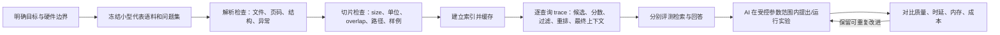

# AI 辅助构建 RAG：可复现、可观察、低配置

## Summary

成熟做法不是让 AI 一次性“搭好 RAG”，而是让它在受控配置和固定评测集上迭代：明确文档解析、切片、增强、索引、候选召回、过滤/重排和最终上下文；为每一步保存可检查结果；分别评测检索与生成；每次只更改可归因的参数并留下实验记录。现有产品/开源项目已提供这套模式的不同部分，但没有一个对所有语料、硬件和隐私边界都适用的默认参数。

低配置电脑优先考虑轻量分阶段流水线、缓存、较小本地 embedding、减少昂贵的逐块 LLM 增强和重排；生成与评测可按隐私条件迁移到云端，也可用量化小模型本地运行。RAGFlow 的可视化解析能力较强，但其快速入门建议 4 CPU 核、16 GB RAM 和 50 GB 可用磁盘，不应当作低配默认方案。

模型权重较大时，可把 embedding 与 rerank 推理托管到按量计费 API，避免本机加载模型。当前国内候选中，无问芯穹和硅基流动的 BGE-M3 / BGE-Reranker-V2-M3 基础 API 标为免费但有限频；PPIO 对 BGE-M3 公布的 embedding 价格为 ¥0.07/百万 tokens。托管 API 只负责模型推理，仍需自己的索引、检索和评测流程。

## Findings

### 1. 市面上的有效模式：三层闭环

1. **摄取与切片可配置、可复查。** 解析器按 PDF/表格/手册/问答等文档类型处理；明确提取、页眉页脚清理、chunk 大小与单位、overlap、结构路径、父子块和可选摘要/关键词。LlamaIndex 的 ingestion pipeline 显示转换链并支持基于节点与转换的缓存；RAGFlow 给出不同解析模板、chunk 配置及切片检查/编辑能力。
2. **查询时留下逐步轨迹。** 记录 query 改写、候选 chunk、各路检索分数、元数据过滤、阈值、rerank 排序、最终 Top-N、送入模型的上下文/Token 数和来源引用。Phoenix/Langfuse 的 trace 方式把检索与生成操作串成可查看的运行树。
3. **在固定数据上做离线评测和回归。** 冻结语料快照、代表性问题集、相关证据标注与配置版本；分别看检索质量和答案质量。Microsoft RAG Experiment Accelerator 展示了参数矩阵、生成问题、指标、图表和 CSV 报告的工程模式。

因此，AI 更适合充当“受限实验操作者”：提出参数候选、修改允许的配置、运行固定评测、解释变化并保存实验记录。评测器和基准集应固定，不能让 AI 同时改被测系统与评分规则。

### 2. 用户要求的透明度应体现在数据契约中

不能只写“已 embedding / 已检索”。每个文档及每个查询都应能沿路径反查：

`原文件/页码/章节 → 解析文本 → chunk_id 与父子/标题路径 → embedding/词法索引 → Top-K 候选与原始分数 → 过滤/重排及原因 → 最终 Top-N → 实际上下文与 Token 数 → 回答及引用`

摄取报告至少包含：语料版本/文件哈希；文件识别类型和解析器版本；原始页数/字符数；提取成功、空文本、排除/去重文件及原因；标题/页码/表格/元数据；chunk 数量分布（最小、中位数、P95、最大）；chunk 尺寸和单位；overlap 单位与值；分隔规则；每个 chunk 的源跨度、前后邻接 chunk、父块/子块 ID；解析前后样例；失败记录。

查询报告至少包含：原始问题与改写问题；检索通道和各自权重；初筛 Top-K；每个候选的来源、片段、向量/词法分数、融合分数、元数据条件；被阈值/过滤器排除的候选和排除原因；reranker 模型、输入顺序与分数；最终 Top-N 的顺序；实际发送给生成模型的文本、引用映射和输入 Token 数。敏感数据允许脱敏，但应保留可核验的标识和判定理由。

**术语必须分开报告：** 文档切片（index-time chunking）；上下文压缩（query-time contextual compression，可选）；召回 Top-K；重排后 Top-N。若使用压缩，应保存压缩前后文本/Token 数、被保留的源跨度及丢弃原因，不能把“压缩”笼统当成切片。

### 3. 参数没有通用最优解，实验要报告语料和证据路径

- RAGFlow 提供 512-token 默认目标、overlap ratio 等配置示例；Weaviate 文档的 100–150 词/约 50 词 overlap 也只是可测的起点；NVIDIA 工程实验报告了不同 token 块长和 overlap 并得到特定 FinanceBench 上的最佳组合。这些数字对应不同切分单位、模型、数据和任务，不能横向当作普适推荐。
- Microsoft 建议按文档结构选择策略、检查真实切片并比较；过小块会损失必要上下文。标题路径、页码、表格结构以及父子块可能比单纯扩大 chunk 更重要。
- AutoRAGsearch 的小型个人实验中，某个 NQ 子集的文档适配 512-token chunk，因此调 chunk 没带来效果；该 README 同时记录了 CPU rerank 较慢及更大 cross-encoder OOM。此项目不是独立基准，但展示了两个重要反例：切片调参未必是主要收益来源；硬件瓶颈要记录到实验日志。
- ACL 2026 HiChunk 论文指出常见 RAG 基准可能因证据稀疏而不足以比较切片策略。评测 chunk 方案时，除最终 QA 外，也需知道 gold evidence 落在哪些 chunk、是否被召回、边界是否截断证据。

建议先做小网格而非“让 AI 猜最佳值”：例如选 2–3 个尺寸和 2 个 overlap，保持同一解析器、嵌入模型、问题集和 Top-K；保存配置、日志、检索候选、指标、时延和内存。具体数值由文档形态和机器决定。

### 4. 评估要拆开检索和生成，合成数据只能辅助

- 检索：人工相关性标注优先；计算 Recall@k、Precision@k、MRR、NDCG。回答对错之前先确认正确证据是否进入上下文。
- 生成：检查 faithfulness/groundedness、answer relevance、completeness，并核验引用是否真的支持回答。Ragas 文档收录了 context precision/recall、faithfulness 等指标。
- 问题集：先从真实使用问题和人工核验的证据建立小型基准；AI 生成问题可扩展覆盖面，但需人工抽样检查并作为独立标签。2025 年一项研究发现，合成 QA 对检索器的排序与人工标注较一致，却不能稳定比较不同生成模型，可能存在任务/风格偏差。
- 记录每次实验的 corpus snapshot、解析/embedding/reranker/generator 版本、配置、随机种子（适用时）、机器、运行时间、内存峰值、模型调用成本和结果。升级数据或模型后重新建立基线。

### 5. 低性能电脑上的实用分层

| 机器/约束 | 实践起点 | 需要接受的取舍 |
|---|---|---|
| CPU/内存紧张，语料可出机 | 本地抽取、轻量 embedding 与本地向量/词法索引；云端生成和评测（先确认隐私/费用允许）；关闭逐 chunk LLM 摘要；缓存解析与 embedding | 依赖网络与外部服务；敏感语料不能未经授权上传 |
| 需要离线 | 小型、多语种/中文适配 embedding；减少并发和 Top-K；CPU reranker 先关闭或只对少量候选运行；小型量化生成模型、较短上下文 | 速度较慢，答案质量可能下降；须按目标中文语料实测 |
| 想先看可追溯检索 | llama.cpp retrieval 示例可本地显示源文件、位置、相似度和原文，并调整 chunk/Top-K | 示例只是最小检索原型，不包含完整 PDF 解析、评测、生成链路 |
| 想要端到端图形界面 | RAGFlow 可视化解析/切片和 retrieval test | 官方快速入门建议 4 核、16 GB RAM、50 GB 磁盘；低配机器可能不适合 DeepDoc OCR/版面解析 |

权重量化可以降内存，但权重文件大小不等于应用总 RAM。llama.cpp 的量化文档列出 Llama 3.1 8B 的 Q4_K_M 约 4.9 GB，FP32 约 32.1 GB；运行时还需 KV cache、上下文、索引和系统内存。因此不能据模型权重宣称“8GB 一定能跑”。先在实际电脑测峰值内存、吞吐、冷启动、索引构建时间，再决定模型大小。面向中文语料，embedding 与生成模型都需要用真实中文问题/证据验证；小体积或通用榜单成绩不等于本语料适用。

### 6. 低成本托管 embedding 与 rerank API（2026-10-13）

这类服务通常叫托管模型推理 API 或 MaaS：供应商在云端运行开放权重模型，应用通过 HTTPS API 发送文本并按 token 或请求计费。本机不需要装模型权重，也不用自行运维 GPU。它们不是完整 RAG 服务：embedding 生成向量，向量数据库/搜索引擎负责召回候选；reranker 只对给定 query 和候选文档重新打分排序。

| 服务 | 可用模型与接入 | 当前公开价格/限制 | 适用判断 |
|---|---|---|---|
| 无问芯穹 GenStudio | `bge-m3` embeddings、`bge-reranker-v2-m3` rerank；分别有 `/maas/v1/embeddings`、`/maas/v1/rerank` API | 官方文档当前称两类 API 不收费。每个 API Key：1,000 RPM、250,000 RPD、500,000 TPM；租户还有共享上限 | 推荐作为国内首轮低成本验证；免费与限频规则应以账号控制台为准，峰值负载和生产可用性需单独验证 |
| SiliconFlow 硅基流动 | `BAAI/bge-m3`、`BAAI/bge-reranker-v2-m3`；官方分别提供 embedding 与 rerank API | 当前价格表将基础版两个模型列为免费；Pro 项列 ¥0.07，但价格页本身未显示该行的计费单位，故不据此比较单价 | 可与无问芯穹并行做小样本对照；确认免费模型账号要求、当期限频和部署网络 |
| PPIO 派欧云 | `baai/bge-m3`、`baai/bge-reranker-v2-m3`；兼容 OpenAI 风格的 `/v1/embeddings` 和 `/v1/rerank` | BGE-M3 embedding 输入 ¥0.07/百万 tokens；rerank 输入与输出分别 ¥0.07/百万 tokens。BGE-M3 初始等级 RPM 为 30，账号等级可影响额度 | 国内按量付费备选；价格明确、易做预算估算，但要按实际候选量计算重排调用成本 |
| DeepInfra | `BAAI/bge-m3`、`Qwen/Qwen3-Embedding-0.6B`、`Qwen/Qwen3-Reranker-0.6B`；Qwen embedding endpoint 兼容 OpenAI embeddings API | BGE-M3 与 Qwen3 0.6B embedding/reranker 页面列价均为 $0.01/百万 tokens；Qwen 页面标示 32K 上下文及 zero-retention | 可作为海外托管模型价格参照；须从实际部署网络验证连通性、延迟、付费与数据处理条款。zero-retention 是供应商页面声明 |
| Hugging Face Inference Providers | 将请求路由到多家推理供应商，供探索和切换模型 | 官方说明覆盖 200+ 模型，按提供商价格透传、不加价；免费账号当前没有月度额度，需购买 credits | 适合发现模型和切换服务商，不应假设路由始终选择最低价或目标地区可用 |

**模型候选与许可：** BGE-M3 官方模型卡标注 MIT，描述其支持 100 多种语言、dense/sparse/multi-vector 检索和最多 8,192 tokens；Qwen3-Embedding-0.6B 与 Qwen3-Reranker-0.6B 官方模型卡标注 Apache-2.0。开放权重许可与云 API 的服务条款是两件事：托管商的数据保留、地区、并发、可用性和价格要分别核对。不能把“开放权重”理解成 public domain，也不能由模型许可推断云端请求如何处理。

**验证顺序：**

1. 冻结同一份语料、chunk 配置和中文问题集；记录当前 embedding 基线和候选池。
2. 检查正确证据是否已进入初筛 Top-K。若已进入但顺序差，先用相同候选集单独对照 reranker，不必重建向量索引。
3. 若正确证据没被召回，再对照 BGE-M3、Qwen3-Embedding-0.6B 和当前模型；更换 embedding 后要将文档 chunk 全部重新 embedding 并重建向量索引，不能混用不同模型空间的旧向量。
4. 分开记录 Recall@K、MRR/NDCG、回答质量、端到端延迟、429 限流和实际账单。embedding 的主要成本来自全量建库和后续新增文档；rerank 按查询时送入的候选文本重复计费，应限制候选数并缓存可缓存的结果。

以公开单价粗算，重算 1,000 万 input tokens 的文档向量：PPIO BGE-M3 约 ¥0.70，DeepInfra 的 Qwen3 0.6B 或 BGE-M3 约 $0.10。该数字只估 embedding，不含重排、网络、税费或其他服务，也不做币种换算；检索请求量和候选文本长度会决定 rerank 后续成本。

## 推荐的 AI 协作实验流程

### 可直接交给 AI 的任务约束

> 你是 RAG 实验助手，不要只报告“已 embedding、已检索、已测试”。先读取当前硬件、语料和代码；提出解析、切片、检索和评测配置，并在运行前写出配置文件。每个文件报告识别类型、解析器、页数、提取/排除情况和原因；每个 chunk 报告 ID、源文件/页码/标题路径、父子关系、字符数与 Token 数、overlap、相邻 chunk 和原文样例。分别报告 index-time chunking、query-time compression、召回 Top-K 和重排后 Top-N；压缩时提供压缩前后文本、Token 数、源跨度映射及丢弃原因。每个测试问题输出原问题/改写问题、所有候选及向量/词法/融合/重排分数、过滤条件和淘汰原因、最终上下文、输入 Token 数、回答及引用。检索指标与回答指标分开计算。保存 corpus/config/model 版本、运行时间、峰值内存、错误和结果文件路径。AI 只能修改列出的实验参数，不得更改测试集、gold evidence 或评分实现；先建立基线，每轮只改一个参数或执行已声明的小网格，最后给出差异和可复现命令。缺失的数据明确写“未采集”，不可推测补齐。若硬件超限，先降低并发、候选数、模型/上下文规模或关闭可选 reranker，并记录质量变化。

## Strongest objection / limitations

- 详细 trace 会消耗磁盘并可能暴露文档内容；对用户数据应设权限、脱敏、保留周期。日志可存文本哈希与被授权的可展开样例。
- LLM-as-judge 会有偏差；自动评分不能替代人工抽查。仅用合成测试集可能偏向生成该测试集的模型或风格。
- 可视化产品便于定位问题，但自身资源开销较高；RAGFlow 的默认机器建议不适配所有低配电脑。
- 公开案例提供的是方法和局部数据，不构成特定用户硬件/中文数据集上的性能保证。
- 低价托管 API 的价格不代表延迟、吞吐、上下文限制、协议兼容和错误语义一致。2026 年一项 hosted open-weight API 测量研究指出，同模型服务会随供应商和时间变化，价格相对更稳定，延迟/吞吐/上下文等更容易不同；因此对照要固定语料并记录 provider 与 model ID。
- “Circle Fast” 未能从公开检索结果中匹配到明确的 embedding/rerank 模型或服务 ID，当前不对它的能力和价格作判断。部署地区、语料敏感度、请求量和现有索引也未提供，无法给出最终供应商选择。

## Research quality checks

- **Relevance:** 只保留直接涉及 RAG 摄取、解析/切片、检索轨迹、评测、低资源部署、托管 embedding/rerank API 或 AI 实验流程的材料。
- **Source quality:** 参数和功能优先引用项目官方文档/GitHub；评测局限引用论文或学术会议论文；模型许可引用上游模型卡；工程博客和个人仓库只用于实例，不作为普遍性能结论。
- **Contrarian check:** 特别检查了 chunking 未必改善短文档语料、合成问题集可能误评生成模型、证据稀疏会掩盖切片差异、可视化工具自身的资源开销，以及托管服务的限频、可达性和同名模型服务差异。
- **Citation cleanup:** 价格和配额注明查证日期及原币种；对未展示计费单位的价格不作单价比较；厂商/仓库示例没有写成普适最佳配置；结论附近保留直接来源链接。
- **Insights:** AI 辅助 RAG 的关键在于被测配置可控、证据路径可见、测试集/评分器固定。托管推理解决本机权重和算力问题，但不替代索引、候选召回和评测；若相关证据未进入候选池，单换 reranker 无法补回。应把“可追溯的逐项实验报告”作为交付物，而非一句运行状态总结。

## Sources

1. Microsoft, [RAG solution design and evaluation guide](https://github.com/microsoftdocs/architecture-center/blob/main/docs/ai-ml/guide/rag/rag-solution-design-and-evaluation-guide.md) — 分阶段实验、结构化切片、评测与结果可视化。
2. Microsoft, [RAG chunking phase](https://github.com/microsoftdocs/architecture-center/blob/main/docs/ai-ml/guide/rag/rag-chunking-phase.md) — 按文档类型比较切片并检查上下文。
3. Microsoft, [RAG Experiment Accelerator](https://github.com/microsoft/rag-experiment-accelerator) — 参数矩阵、报告图表与 CSV；依赖 Azure 服务，不是纯本地方案。
4. RAGFlow, [Dataset configuration](https://github.com/infiniflow/ragflow/blob/main/docs/guides/dataset/configuration.md), [Retrieval testing](https://github.com/infiniflow/ragflow/blob/main/docs/guides/dataset/retrieval_testing.md), [Quickstart](https://ragflow.io/docs/v1.0.0-rc1/) — 解析模板、块与 overlap 配置、候选分数/过滤/重排检查及官方机器建议。
5. LlamaIndex, [Ingestion pipeline](https://developers.llamaindex.ai/python/framework/module_guides/loading/ingestion_pipeline/) — 明确 transformation 与缓存。
6. Arize Phoenix, [RAG evaluators](https://github.com/Arize-ai/phoenix/blob/main/.agents/skills/phoenix-evals/references/evaluators-rag.md), [Tracing tutorial](https://github.com/Arize-ai/phoenix/blob/main/js/examples/apps/tracing-tutorial/README.md) — 检索/生成分开评测和运行轨迹。
7. Langfuse, [Headless Langfuse From Your Coding Agent](https://langfuse.com/guides/videos/headless-langfuse), [RAG observability and evals](https://langfuse.com/blog/2025-10-28-rag-observability-and-evals) — 编码 Agent 接入 trace、分析失败样本、回归集与评测；厂商示例，不是独立比较。
8. NVIDIA, [Finding the best chunking strategy](https://developer.nvidia.com/blog/finding-the-best-chunking-strategy-for-accurate-ai-responses/) — 公开特定数据集上的块长/overlap 对照，不应泛化为全局最优值。
9. Weaviate, [Generative search starter guide](https://docs.weaviate.io/weaviate/starter-guides/generative) — 结构化切片和可追溯元数据实践；尺寸数字只是基线候选。
10. Ragas, [Available metrics](https://docs.ragas.io/en/latest/concepts/metrics/available_metrics/) — context precision/recall、faithfulness 等指标定义。
11. Chen et al., [Evaluating Synthetic QA Benchmarks for RAG Systems](https://arxiv.org/abs/2508.11758) — 合成 QA 对检索排序有效，但不能稳定比较生成架构。
12. ACL 2026, [HiChunk: A Hierarchical Chunking Benchmark](https://aclanthology.org/2026.acl-long.1372/) — 讨论证据稀疏对现有切片评测的影响。
13. llama.cpp, [Retrieval example](https://github.com/ggml-org/llama.cpp/blob/master/examples/retrieval/README.md), [Quantization](https://github.com/ggml-org/llama.cpp/blob/master/tools/quantize/README.md) — 轻量本地检索演示、来源位置输出与权重内存对比。
14. AutoRAGsearch, [GitHub repository](https://github.com/Smasko7/AutoRAGsearch) — 让编码 Agent 仅在受控 pipeline 参数范围内跑实验的个人示例；结果和硬件数据不作外部验证。
15. petrello, [on-device-rag](https://github.com/petrello/on-device-rag) — 标注为实验性的小型设备端示例，不应视为生产级评估。
16. 无问芯穹 GenStudio, [Embedding API](https://docs.infini-ai.com/gen-studio/api/retrieval/tutorial-embeddings.html), [Rerank API](https://docs.infini-ai.com/gen-studio/api/retrieval/tutorial-rerank.html), [API rate limits](https://docs.infini-ai.com/gen-studio/api/usage-and-billing/rate-limit.html) — 模型 API、免费计费说明与各级 RPM/RPD/TPM。
17. SiliconFlow, [pricing](https://www.siliconflow.cn/pricing), [embedding API](https://siliconflow.readme.io/reference/createembedding), [rerank API](https://siliconflow.readme.io/reference/creatererank), [rate limits](https://docs.siliconflow.cn/docs/userguide/faqs/rate-limit-and-upgradation) — BGE 模型价格、请求格式和限频说明。
18. PPIO, [BGE-M3 embedding API and price](https://ppio.com/model/embedding/baai/bge-m3), [BGE reranker API and price](https://ppio.com/model/reranker/baai/bge-reranker-v2-m3), [pricing](https://ppio.com/pricing) — 模型 ID、兼容 API、百万 token 单价和限频等级。
19. DeepInfra, [embedding model catalog](https://deepinfra.com/models/embeddings), [Qwen3-Embedding-0.6B API](https://deepinfra.com/Qwen/Qwen3-Embedding-0.6B/api), [Qwen3-Reranker-0.6B](https://deepinfra.com/Qwen/Qwen3-Reranker-0.6B) — 海外托管服务定价、上下文和 API 调用示例；zero-retention 为供应商声明。
20. Qwen, [Qwen3-Embedding-0.6B model card](https://huggingface.co/Qwen/Qwen3-Embedding-0.6B), [Qwen3-Reranker-0.6B model card](https://huggingface.co/Qwen/Qwen3-Reranker-0.6B); BAAI, [BGE-M3 model card](https://huggingface.co/BAAI/bge-m3) — 官方模型许可和能力说明。
21. Hugging Face, [Inference Providers pricing and billing](https://huggingface.co/docs/inference-providers/en/pricing) — 多供应商路由、provider 价格透传和月度额度。
22. Li et al., [When Is the Same Model Not the Same Service?](https://arxiv.org/abs/2605.02821) — 2026 hosted open-weight API 时间变化与提供商差异的测量研究。
23. Alibaba Cloud Model Studio, [model pricing](https://www.alibabacloud.com/help/en/model-studio/model-pricing), [data retention policy](https://www.alibabacloud.com/help/en/model-studio/data-retention-policy) — 对比服务的区域价格和默认保留政策；当前北京区 rerank 列表未列 `qwen3-rerank`，不纳入首选清单。
24. Tencent Cloud, [ES AI Search model inference API](https://cloud.tencent.com/document/product/845/127669), [Smart Search pricing](https://intl.cloud.tencent.com/zh/document/product/845/78876) — 可复用既有 ES AI Search 集群的模型推理方案；如没有该集群，须把集群成本计入比较。

## Open questions

- 具体机器的 CPU、RAM、GPU/显存、系统和语料规模未提供，不能推荐确定的本地模型尺寸或耗时。
- 文档格式、中文/多语种比例、扫描 PDF 比例、表格/图片复杂度及隐私约束未知，需据此选择 parser 和云/本地边界。
- 尚未对用户的具体语料生成人工核验的 gold evidence 与代表性问题，当前仅能给通用实验方法。
- “Circle Fast” 的准确模型 ID/服务商未知；尚未取得用户机器和产品部署地区、月 token 用量、数据敏感等级，无法将上述公开单价换算成生产总成本或确定 API 可达性。

## Timeline

- 2026-10-12: 完成资料调查，整理可解释流水线、AI 受控实验、低配置取舍和验证限制。
- 2026-10-13: 增补低成本托管 embedding/rerank API、公开价格与限频、模型许可、云端服务稳定性风险和对照评测建议。
